# 优化建议 · 大厂对标实测（第二轮回归配套）

- **依据**：全部条目基于 2026-10-09-02 回归实测截图与探针取证（引用 `./screenshots/…` 相对路径），辅以源码静态核对；无臆测项。
- **对标对象**：Google Drive、Dropbox、Notion、Linear、VS Code Web（均为业界既有惯例，非想象功能）。
- **铁律**：本文档仅为建议，本轮未改动任何代码。
- **优先级口径**：P1=当前能力缺失或明显折损用户信任，尽快做；P2=显著体验增益；P3=打磨项。
- 缺陷级记录（含修法）见《回归测试报告.md》⑤，本文不重复编号，只从「对标」视角组织。

---

## 一、界面人性化（把用户当人：少问、说清、给退路）

### 1.1 搜索不应要求用户「先扫描」——冷启动给引导或后台预热

- **现状实测**：未扫描时搜索任何词都是「无匹配结果」空态，仅底部一行小字暗示索引范围，无任何行动入口：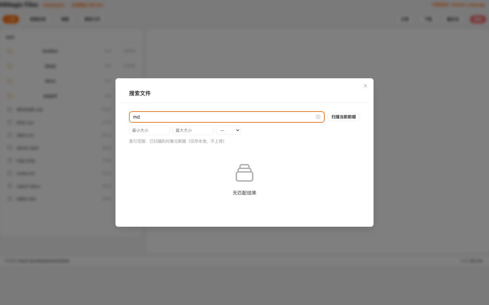。扫描后才有结果：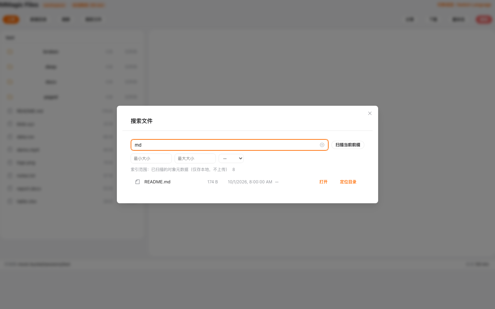。
- **大厂做法**：Google Drive / Notion 的搜索开箱即用（后台建索引），用户永远不需要理解「索引」概念；本地索引类产品（如 Listary/Everything）也会在空索引时明确提示「正在建立索引/点此扫描」。
- **建议**：① 空态文案改为「索引为空：点『扫描当前前缀』建立本地索引」并把扫描按钮内嵌到空态里；② 进阶：进入工作台后后台低优先级自动扫描预热（走现有 `scan(rootPrefix, client)`），扫完静默入索引。
- **优先级**：P1（当前「搜不到=功能坏了」的误读成本高）。

### 1.2 大文件确认不该「确认完再拒」——一次说清结局

- **现状实测**：25.1MB csv 先弹「文件较大（25.1MB）…是否继续？」，确认后仍被渲染器「CSV 过大（>20MB）」拒绝： → 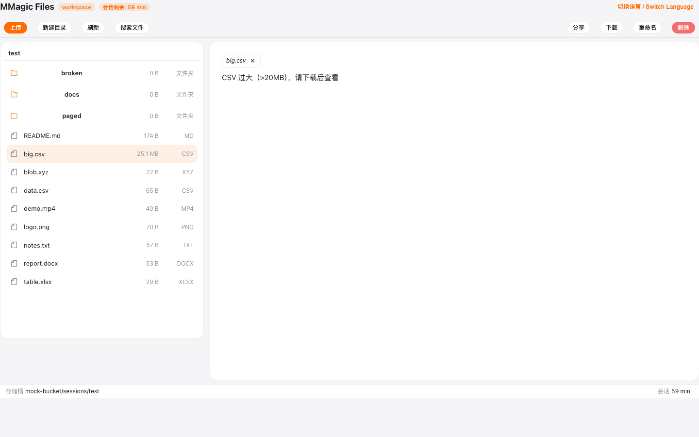；而 6.3MB md 连确认都不问直接拒：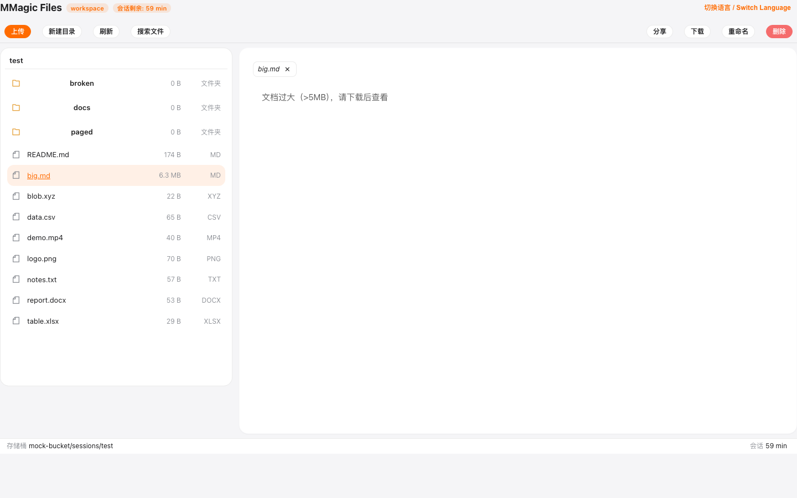。
- **大厂做法**：Google Drive 对超出预览能力的文件只说一次「无法预览此文件类型/大小」并直接给下载入口，从不「先问能不能、再告诉你不行」；Dropbox 大文件页同样一步到位。
- **建议**：把渲染器限额并入预览闸（registry 登记 `maxBytes`），该类型实际拒绝线 = min(渲染器限额, 50MB)，确认只出现在「确认后确实能看」的区间；拒绝节点统一「原因 + 下载」双元素（现有 fallback 已是这个形态，直接复用）。
- **优先级**：P1（浪费用户决策 + 损耗对确认框的信任）。

### 1.3 冲突对话框的第三态不该靠「猜 X 的意思」

- **现状实测**：可见按钮只有「跳过/覆盖」，第三态（整批取消）藏在右上角裸 X 里，词典里现成的「取消上传」文案从未渲染：。
- **大厂做法**：Dropbox/OneDrive 上传冲突是三显式按钮：「替换 / 保留两者 / 跳过」，每个后果一目了然；不成文惯例是「破坏性选项永远可见、可读」。
- **建议**：短期给 X 补 tooltip「取消上传（整批不入队）」（用上 conflict-abort 键）；中期冲突框改自绘三钮（覆盖/跳过/取消上传）。
- **优先级**：P2。

### 1.4 弹窗层级穿透——底层错误卡文字盖在向导表单上

- **现状实测**：boot 错误页打开「连接到 S3」向导后，错误卡大标题、code 行、按钮文字叠在弹窗与表单之上：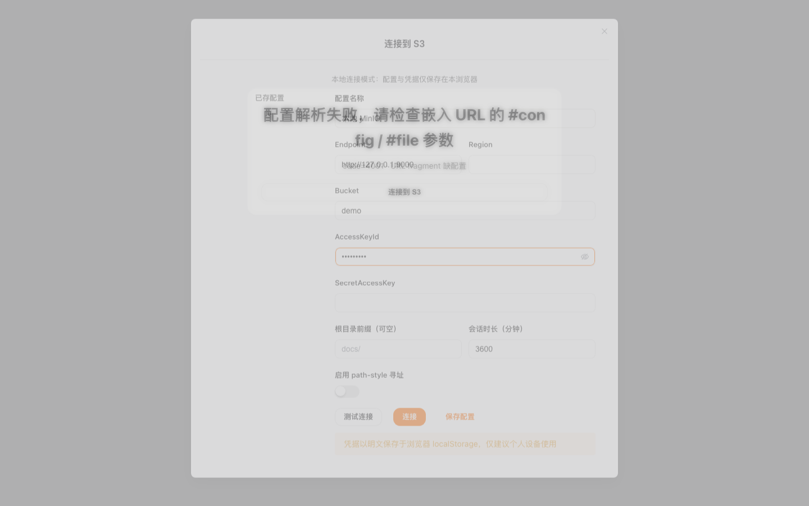（对照正常态 ）。
- **大厂做法**：所有成熟产品的模态弹窗都是视觉孤岛（遮罩 + 高层级 + 底层内容不可交互不可见），从未出现底层文字穿透。
- **建议**：修 FcDialog/遮罩 z-index 层级，并排查 `.home-hero` 上的 stacking context 来源；加一条「打开向导后截图无文字叠压」的视觉断言。
- **优先级**：P2（场景少但一旦遇到极伤观感）。

### 1.5 状态化按钮：已暂停的任务不该并列灰显「暂停」+「继续」

- **现状实测**：已暂停行同时渲染灰显「暂停」和可用「继续」：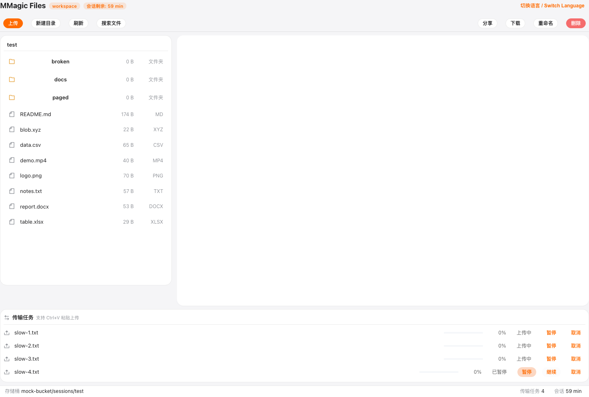。
- **大厂做法**：Drive 下载/同步列表、Linear 的进行中条目，行内只出现当前可用的那一组动作；禁用态按钮只用于「暂时不可用但即将可用」。
- **建议**：暂停钮 `v-if` 收敛为仅 uploading；每行固定一个主动作位（上传中→暂停 / 已暂停→继续 / 失败→重试）。
- **优先级**：P3。

### 1.6 时间与单位的全局一致性

- **现状实测**：zh-CN 下搜索结果时间是「10/1/2026, 8:00:00 AM」：；大小单位三种写法并存（树「6.3 MB」/确认框「25.1MB」/文案「>5MB」）：。
- **大厂做法**：Drive 在中文环境下时间一律「2026/10/1 08:00」、大小一律「12.3 MB」；全站只有一个格式化函数。
- **建议**：收敛 `formatBytes` 与 `formatDateTime` 两个工具函数，i18n 注入 locale；词典里硬编码的 >5MB/>20MB/>50MB 改占位符。
- **优先级**：P2。

---

## 二、功能合理化（能力补全：把已建好的系统接完最后一根线）

### 2.1 ⌘K 命令面板：修好入口 + 补「传输」命令

- **现状实测**：⌘K/Ctrl+K 在工作台无任何响应（面板 DOM=0）：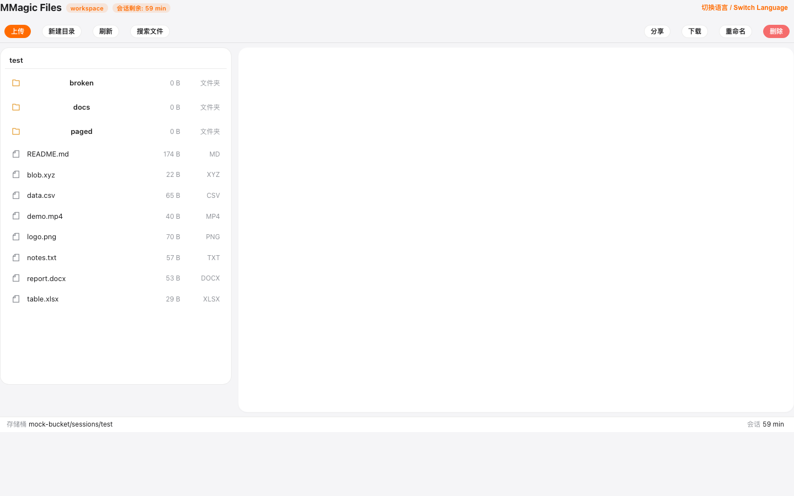；静态核对：唯一快捷键绑定在从未挂载的 AppLayout，且已注册的 4 条命令（搜索/刷新/回根/切语言）不含传输面板。
- **大厂做法**：Linear（⌘K 万物入口）、VS Code Web（⌘P 文件 / ⌘⇧P 命令）都把「命令面板可达性」当作一级能力；面板内必然包含「上传/打开设置/跳转」这类高频动作。
- **建议**：① 快捷键上移 App.vue（一行级改动）；② 命令清单补「打开传输面板」「暂停/恢复全部传输」「新建目录」；③ 输入框旁常驻模式提示（「输入 > 执行命令」），现 UI 有 hint 标记但不可达无从验证。
- **优先级**：P1（功能已建成但 0 可达，ROI 最高的修复）。

### 2.2 分页器补「总数」与「每页条数」

- **现状实测**：深目录分页条只有 « ‹ 1/2 › » + 跳页输入，不显示总数：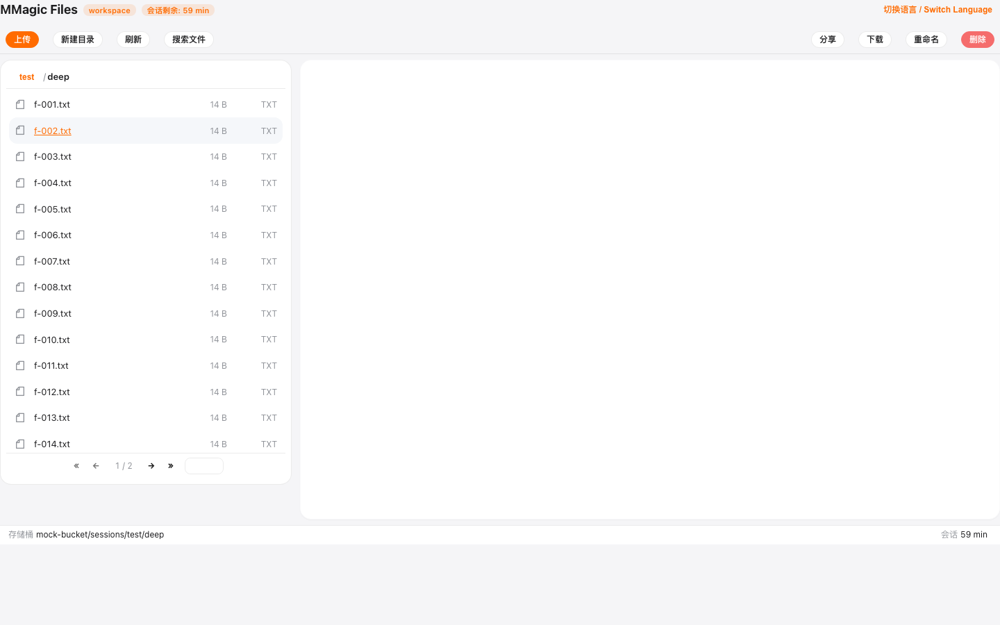。
- **大厂做法**：Drive 列表底部的「1–100 / 共 128 个项目」；Notion 数据库视图同样给总数。总数是用户判断「东西都在不在」的关键信息。
- **建议**：页码旁补「共 {n} 项」；>500 项时提供每页 50/100/200 切换（聚合 list 已支持翻页，前端已知总数）。
- **优先级**：P3。

### 2.3 分享链接：从「生成即忘」到「本地可管理」

- **现状实测**：分享对话框一次生成 GET/PUT 两条预签名链 + 复制 + 有效期选择：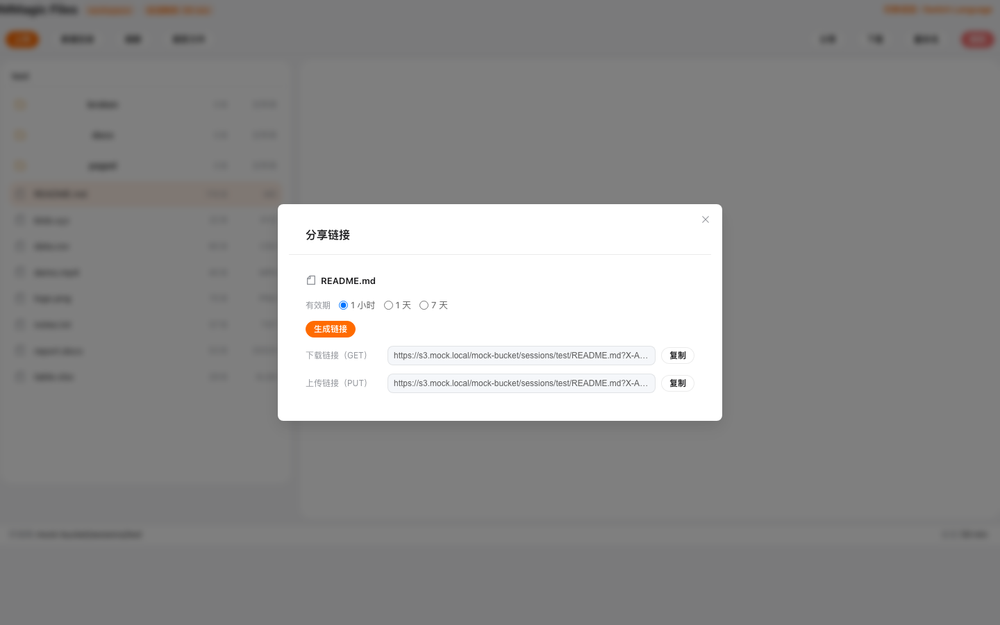。生成后无处查看/复用，关掉即丢。
- **大厂做法**：Drive 的「共享」面板有「已生成链接 + 权限 + 到期 + 撤销」的持续管理；S3 预签名虽无法服务端撤销（签名自包含），但至少可以本地留痕。
- **建议**：把已生成链接（key/到期时间/生成时刻）存 IndexedDB，分享对话框加「最近生成」列表（可再复制、可看剩余有效期）；文案注明「到期前任何人持链接可访问」的安全提示。
- **优先级**：P3（低成本高感知）。

### 2.4 传输中心补聚合控制与速度/剩余时间

- **现状实测**：传输面板逐条有 暂停/继续/取消/重试，但无「全部暂停/继续」、无速度与 ETA：。
- **大厂做法**：Drive 下载列表、Dropbox 同步面板都有全局「暂停全部/恢复全部」+ 每条速度/剩余时间；批量场景下逐条操作是反人类。
- **建议**：面板标题行加 全部暂停/全部继续（queue 已有 pauseAll/resumeAll API，纯 UI 接线）；速度用滑动窗口估算，ETA=剩余字节/速度。
- **优先级**：P3。

### 2.5 预览 tab：淘汰可视化与中键关闭

- **现状实测**：tab 条支持预览态替换/双击钉住/LRU8（wb-06 ✅、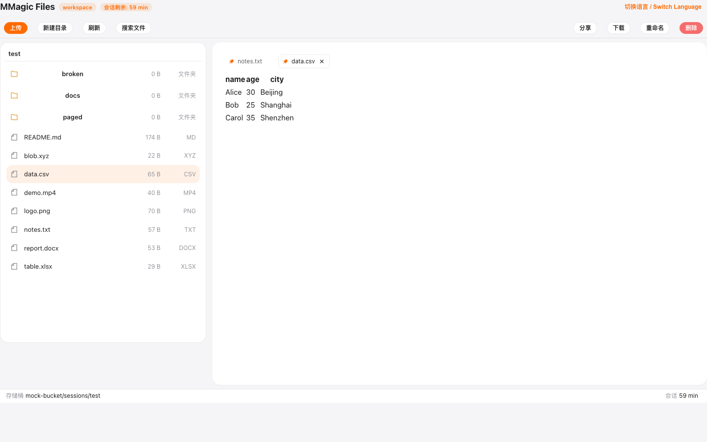），但 LRU 淘汰发生时用户无感知，tab 也无中键关闭。
- **大厂做法**：VS Code 的编辑器 tab：中键关闭、钉住图标、超开上限时下拉「更多 tab」；被关闭的进度类面板会 toast 告知。
- **建议**：① 鼠标中键点击 tab = 关闭（防误双击）；② LRU 淘汰非钉住 tab 时 toast「已关闭最久未用的预览（可在 tab 上双击钉住防止被淘汰）」。
- **优先级**：P3。

---

## 三、布局仿大厂（信息架构与密度）

### 3.1 StatusBar 补「上下文统计」：对象总数 / 选中数 / 选中大小

- **现状实测**：StatusBar 当前为「存储桶路径 | 传输任务 n | 会话剩余」：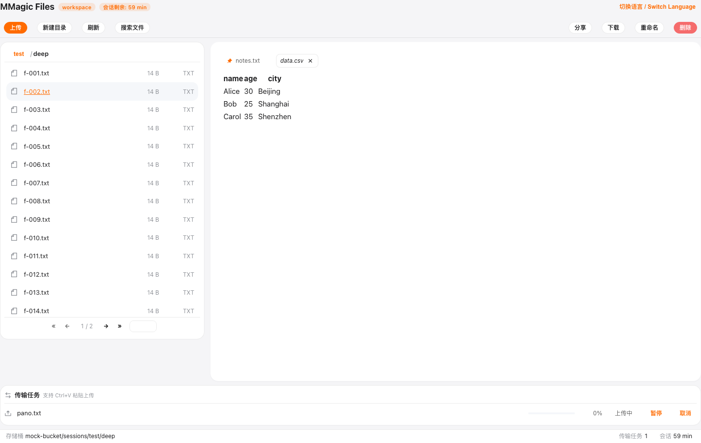。
- **大厂做法**：VS Code Web 底栏左侧是位置上下文、右侧是状态；Finder/Drive 在列表底部或顶部常驻「n 个项目，选中 m 个，共 xx MB」——批量操作前用户靠它确认选区。
- **建议**：左区补「当前目录 n 项（第 x/y 页）」；多选时中间区显示「已选 m 项 / xx MB」（多选删除确认前的关键信息，现有 wb-03 的 {n} 确认框也能受益）。
- **优先级**：P3。

### 3.2 csv 表格视图的表格感（网格线/表头/对齐）

- **现状实测**：「表格视图」实际无边框、无表头底色、无数字右对齐，观感如纯文本：。
- **大厂做法**：Notion 数据库 / Google Sheets 的表格三件套：固定表头 + 网格线 + 类型对齐（数字右、文本左）；Drive 打开 csv 也是带样式的表格。
- **建议**：表头加底色与边框、行分隔线、数字列右对齐、行 hover 高亮（若已有则补前两项）；大表加首列/表头 sticky。
- **优先级**：P3。

### 3.3 工具栏主次分组：保持现状，统一主色

- **现状实测**：左侧主操作（上传/新建目录/刷新/搜索文件）+ 右侧次操作（分享/下载/重命名/删除）：——分组已符合大厂「主左次右」惯例。
- **大厂做法**：Drive 的「+ 新建」是全页唯一主色钮；破坏性操作（删除）用红但降饱和。
- **建议**：保持布局；「上传」钮已是品牌橙 primary（好）；「删除」红色确认链已具备。唯一要修的是弹窗类主按钮的品牌色统一（见 4.1）。
- **优先级**：观察项（无需改动，防倒退）。

---

## 四、细节仿大厂（最后 5% 的质感）

### 4.1 弹窗主按钮品牌色统一（蓝→橙）

- **现状实测**：冲突/大文件确认框主按钮是 Element 默认蓝，与全站品牌橙并存： 。
- **大厂做法**：Drive/Linear 全产品一个主色，对话框主按钮与页面主按钮永远同色。
- **建议**：全局覆盖 `.el-message-box__btns .el-button--primary` 主色为品牌色（一处 scss），或统一走 FcConfirm。
- **优先级**：P3。

### 4.2 painter：工具条样式化 + 导出格式提示

- **现状实测**：画板工具条是原生按钮（笔刷 2/5/10、清空、保存）缩在左上角：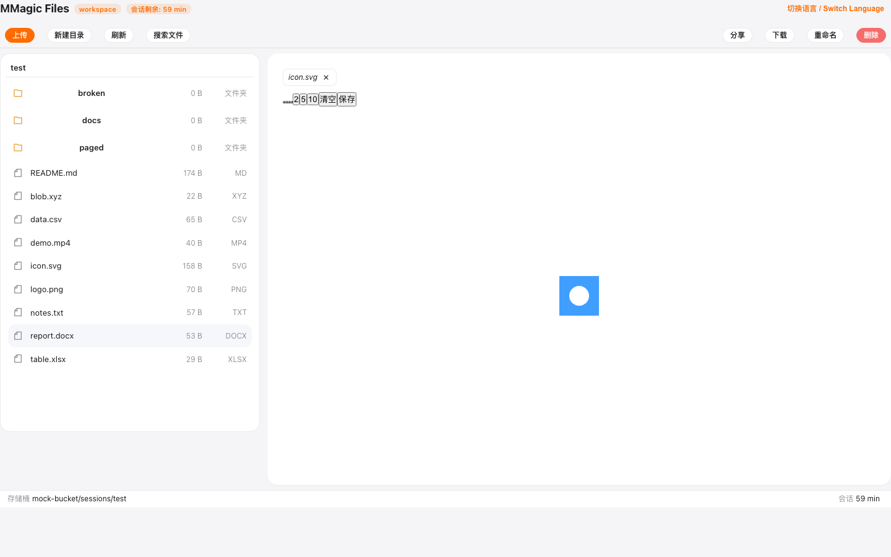；svg 保存静默变 PNG：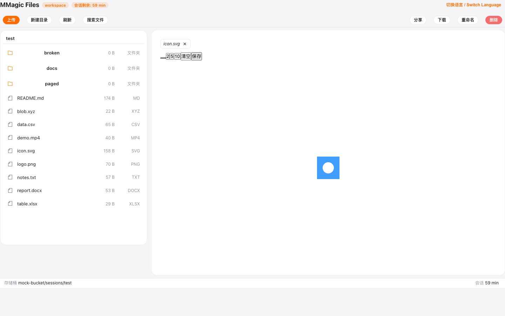。
- **大厂做法**：Excalidraw/Figma 的工具条是图标化、悬浮式、带 tooltip 的标准件；导出时明确选择格式（PNG/SVG），格式降级必提示。
- **建议**：① 工具条套 FcButton + remixicon + tooltip；② mime 降级时保存前弹确认「将以 PNG 位图覆盖原 svg」。
- **优先级**：P3（提示部分建议提到 P2，涉数据正确性预期）。

### 4.3 键盘流帮助面板（「?」呼出快捷键表）

- **现状实测**：已有 Alt+↑/↓、字母跳转、Esc 清选、双击钉住、Ctrl+V 粘贴等一批键盘能力（探针 ⑧ 实测 Alt+↑ 生效：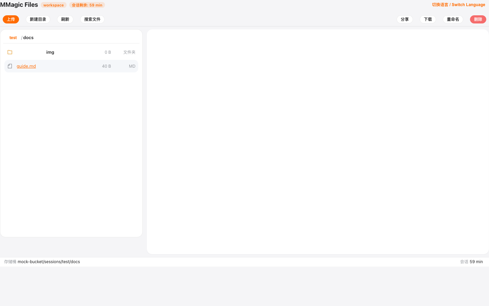 → 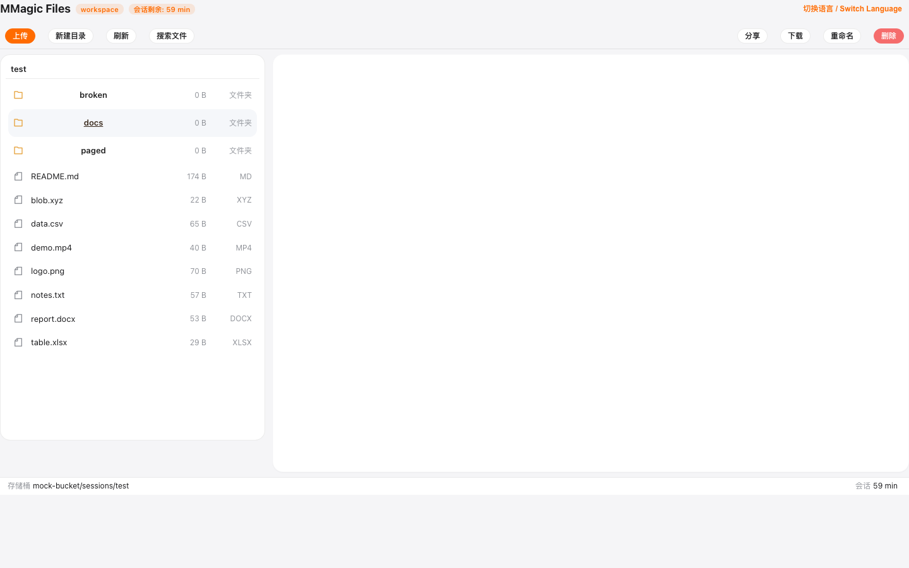），但没有任何地方能发现这些快捷键。
- **大厂做法**：Gmail/Linear/Notion 按「?」呼出快捷键速查表，是键盘流产品的标配发现机制。
- **建议**：监听 `?`（Shift+/，非输入态）弹出快捷键清单对话框；StatusBar 右侧加「? 快捷键」入口。
- **优先级**：P3。

### 4.4 「> 命令模式」的可见性

- **现状实测**：面板支持 `>` 前缀切命令模式（静态核对 `parsePaletteQuery`），但前提是面板能打开（见 2.1）；hint 标记（⌘/esc）样式已备好：静态核对 FcCommandPalette 模板。
- **大厂做法**：VS Code ⌘P 面板左下常驻「输入 > 转命令模式」的实时提示；Slack ⌘K 同理。
- **建议**：随 2.1 修复后，把 hint 从静态图标升级为随模式切换的文案（文件模式显示「> 命令」、命令模式显示「↑↓ 选择 ⏎ 执行」）。
- **优先级**：P3。

### 4.5 上传完成后的「入树」反馈增强

- **现状实测**：上传完成树自动刷新（F6 修复验证 ✅：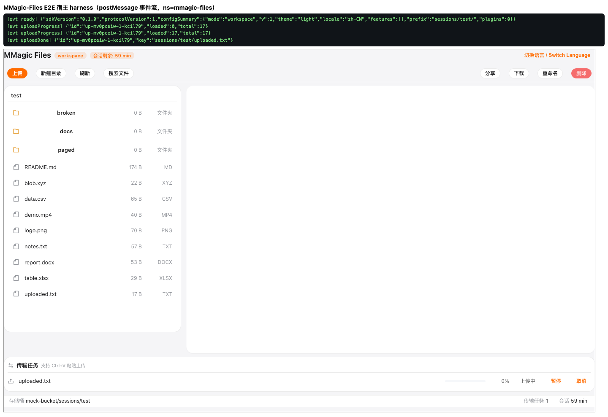），但新行无高亮标记，用户仍需自己在列表里找。
- **大厂做法**：Drive 上传完成后新文件行短暂高亮（背景闪两下）+ toast 内直达链接；Dropbox 会滚动定位到新文件。
- **建议**：树刷新后对新 key 行加 1.5s 高亮动画（CSS 一次性 class）；多文件上传完成 toast 提供「定位第一个新文件」。
- **优先级**：P3。

---

## 落地优先级汇总

| 优先级 | 条目 | 一句话 |
| --- | --- | --- |
| P1 | 2.1 | 修 ⌘K 入口 + 补传输命令（能力已建成、0 可达） |
| P1 | 1.1 | 搜索冷启动引导/后台预热 |
| P1 | 1.2 | 大文件闸合并渲染器限额，杜绝「确认后再拒」 |
| P2 | 1.3、1.4、1.6 | 冲突三钮显式化、弹窗层级穿透、时间/单位一致化 |
| P3 | 1.5、2.2~2.5、3.1、3.2、4.1~4.5 | 状态化按钮、分页总数、分享管理、聚合传输控制、tab 淘汰提示、StatusBar 统计、csv 表格感、品牌色统一、painter 工具条、快捷键帮助、上传入树高亮 |

> 与《回归测试报告.md》⑤ 缺陷清单的对应：1.2=R2-03、1.3=R2-04、1.4=R2-02、1.5=R2-10、1.6=R2-05/R2-14、2.1=R2-01、3.2=R2-13、4.1=R2-11、4.2=R2-08/R2-12、1.1/2.2~2.5/3.1/4.3~4.5 为本轮实测衍生的新增建议。
