# MMagic-Files 前端 E2E 回归测试报告（第二轮）

- **报告目录**：`test-report/2026-10-09-02/`（本报告内截图均以相对路径 `./screenshots/…` 引用）
- **被测对象**：`frontend/`（Vue3 + Vite 工作台 / JSSDK iframe 应用），基线 commit `33853d9`（main，工作区干净）
- **测试性质**：黑盒 E2E（真实 Chromium + Playwright），S3 网络层整层 Mock（SigV4 请求按特征应答），宿主 postMessage 通道用同源 harness 页真实收发；另以 /tmp 临时探针脚本（不改仓库任何代码）对本期新功能逐项真人交互取证
- **铁律执行**：本轮未改动 `frontend/src/`、`frontend/e2e/`、测试与 spec 任何一行；探针脚本存放 `/tmp/mmf-probe/`（副本归档于 `./artifacts/probe-scripts/`）

---

## ① 执行摘要

| 项 | 上轮（2026-10-09-01） | 本轮（2026-10-09-02） | 变化 |
| --- | --- | --- | --- |
| E2E 用例规模 | 34（10 业务线 + 预热） | **42**（11 业务线 + 预热） | **+8**（新增业务线 11 工作台交互面 wb-01~07 共 7 条；上传线新增 up-04 重名冲突 1 条） |
| E2E 结果 | 30 通过 / 4 失败（均为故意保留的缺陷佐证用例） | **42 / 42 全绿** | 上轮 4 条佐证用例（render-03、feat-02、feat-03、file-01）已随修复全部转绿并改名「修复验证」 |
| 自动化通过率 | 88.2%（剔除佐证用例 100%） | **100%（42/42）** | — |
| 单元测试 | 63 文件 / 782 通过 + 1 skipped | **79 文件 / 1136 通过 + 1 skipped / 0 失败** | **+16 文件 / +354 用例** |
| 静态检查 | 0 错（含 0 警告口径未留档） | 0 错 / **8 警告**（见 R2-09） | 新增 UI 组件带来 lint 警告 |
| 构建门禁 | 成功（chunk warning 既有） | 成功（主包 **4,075.46 kB**，见 R2-06） | 挂账确认 |
| 本轮新功能取证 | — | **13 组探针 / 20 张截图**（传输中心、搜索、分享、预览 tab、命令面板、向导、键盘流、冲突、分页、大文件闸、painter） | 全部走真实 dev server + S3 Mock |
| 本轮新增发现 | 6（F1~F6，已全部修复） | **14 条新记录（R2-01~R2-14）**：P0×0 / P1×1 / P2×5 / P3×8 | 均只记录不修码 |
| 上轮缺陷回归 | F1~F6 | **F1~F6 全部仍处于闭合状态**（见 ⑤） | — |

**一句话结论**：既有 42 条 e2e 全绿、五门禁全过，上轮 6 个缺陷修复无一回退；新功能面上，传输中心/分享/预览 tab/分页/键盘流/向导/搜索扫描链路全部按承诺工作，但发现 **⌘K 命令面板在真实 UI 中无法唤起（P1）**、boot 页向导弹窗层级穿透（P2）等 14 项新问题，均已附截图证据。

---

## ② 五门禁结果

| # | 门禁 | 命令 | 结果 | 备注 |
| --- | --- | --- | --- | --- |
| ① | 类型 | `pnpm typecheck`（vue-tsc -b --noEmit） | **0 错**（exit 0） | — |
| ② | 静态检查 | `pnpm lint`（eslint src/**/*.{ts,vue}） | **0 error / 8 warning**（exit 0） | PreviewTabs.vue 1、StatusBar.vue 2、AppLayout.vue 5（均 local/prefer-fc-button，见 R2-09） |
| ③ | 单元测试 | `pnpm vitest run` | **79 文件 / 1136 通过 / 1 skipped / 0 失败**，9.86s | skipped 为既有 skip |
| ④ | E2E | `pnpm exec playwright test` | **42 passed (45.0s)**，0 failed / 0 flaky | 串行 1 worker；日志 `./playwright-run.log` |
| ⑤ | 构建 | `pnpm build`（vue-tsc -b && vite build） | **成功**，vite build 19.94s | 主 chunk `index-CIKMI5h4.js` **4,075.46 kB / gzip 1,050.97 kB**，触发 >1100kB 警告（R2-06）；其余大块：heic2any 1352.91、elk 1476.52、element-plus 1071.07 kB |

E2E 证据目录说明：`playwright.config.ts` 的 outputDir/截图目录仍指向 `test-report/2026-10-09-01/`（铁律不改配置）。本轮用 `--output` CLI 参数把运行产物重定向到 `2026-10-09-02/artifacts/`；套件 59 张 pass 截图落在 01 目录（与轮 6 同一既定流程，文件名不变、内容刷新，其中 7 张字节级更新），**已全量复制归档到 `2026-10-09-02/screenshots/`**。本轮 0 失败，故无 trace/失败截图归档项（「fail 完整证据」原则本轮无触发对象）。

---

## ③ 业务线结果矩阵

| # | 业务线 | 用例 | 通过 | 关键截图（本轮实拍，`./screenshots/`） |
| --- | --- | --- | --- | --- |
| 0 | 预热（重依赖预构建 + 基线全景） | 1 | 1 | 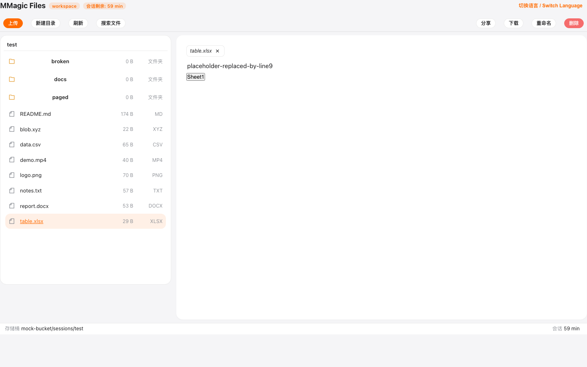 |
| 1 | boot 错误态 | 3 | 3 |  |
| 2 | workspace 浏览 | 4 | 4 |   |
| 3 | 渲染器预览 | 8 | 8 | 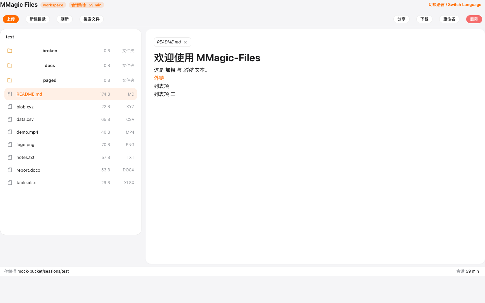 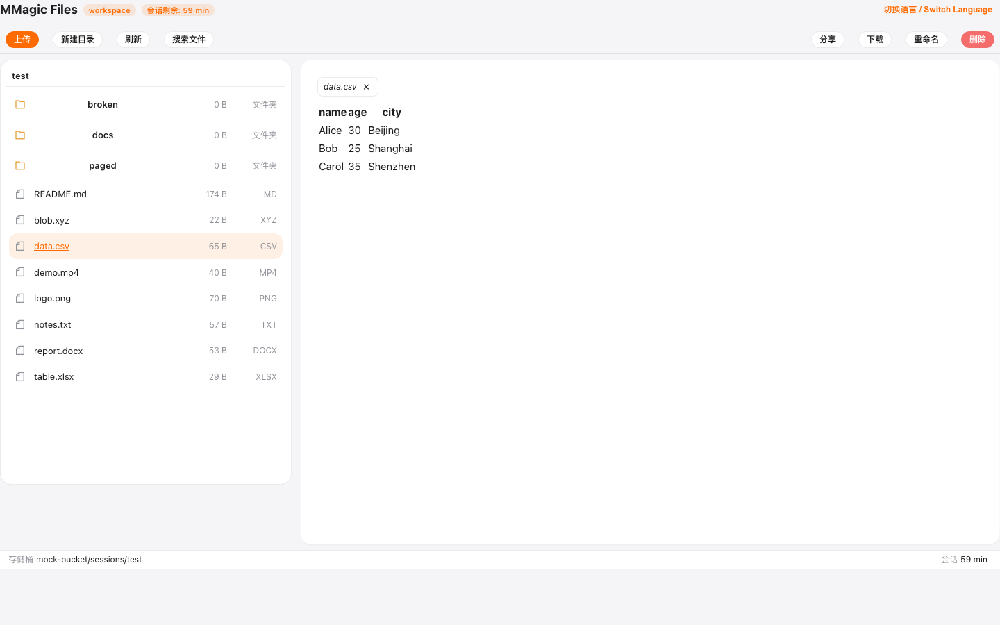  |
| 4 | 工具栏操作 | 4 | 4 | 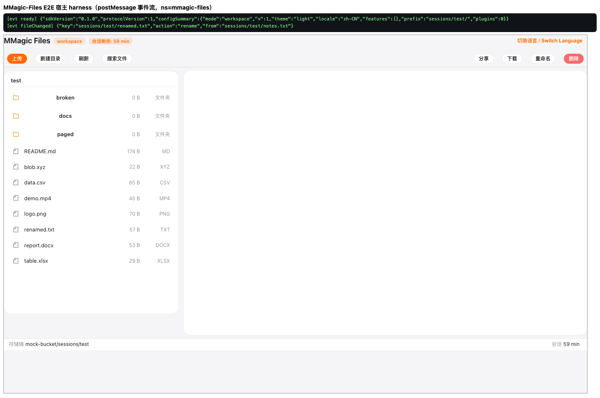 |
| 5 | 上传（含 up-04 重名冲突，**新增**） | 4 | 4 |  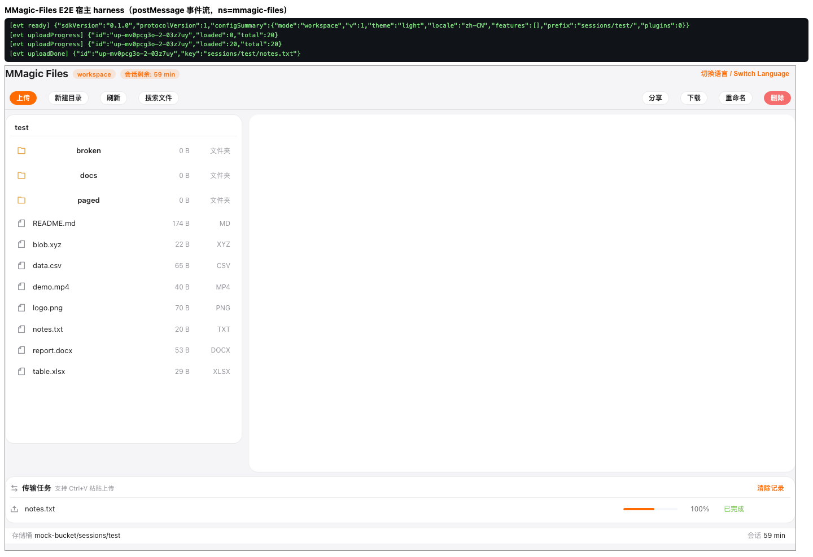 |
| 6 | 会话到期 | 2 | 2 | 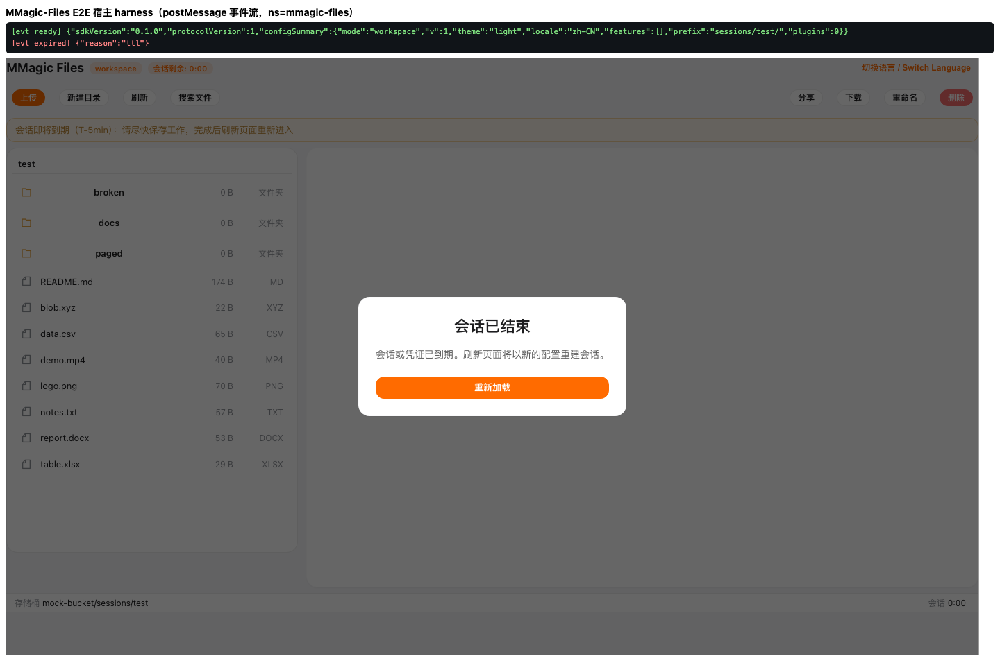  |
| 7 | features 门控 | 3 | 3 | 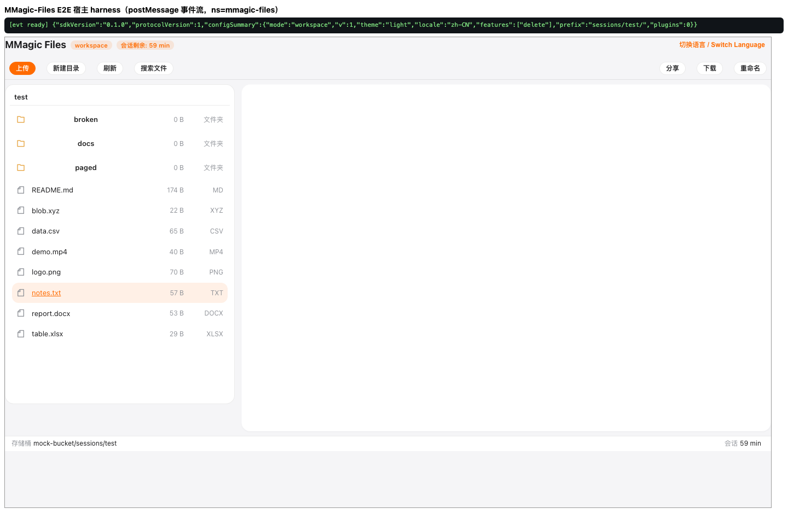 |
| 8 | 单文件模式 | 2 | 2 | 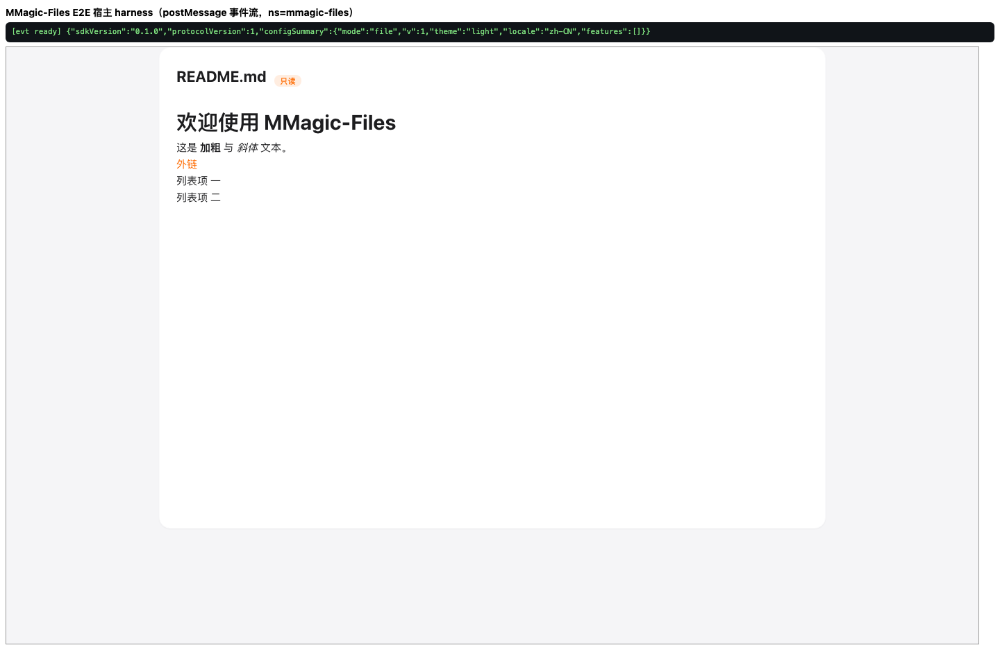 |
| 9 | office 预览 | 2 | 2 | 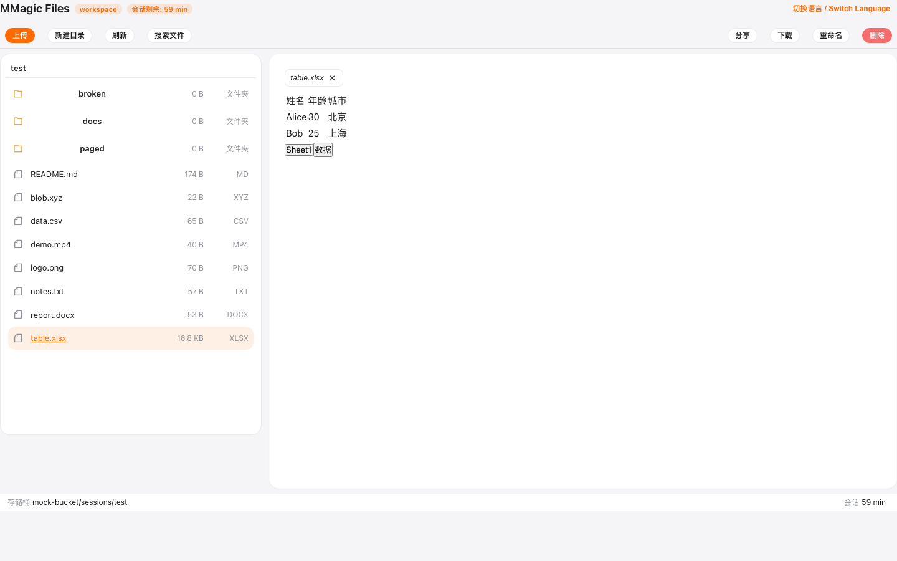 |
| 10 | 插件失败路径 | 2 | 2 |  |
| 11 | 工作台交互面（**整线新增** wb-01~07） | 7 | 7 | 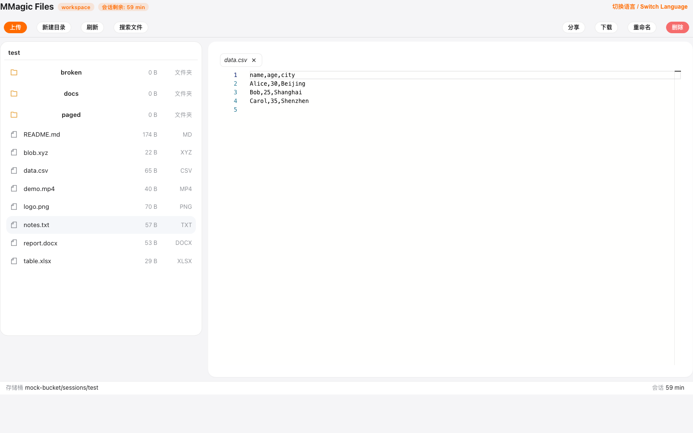 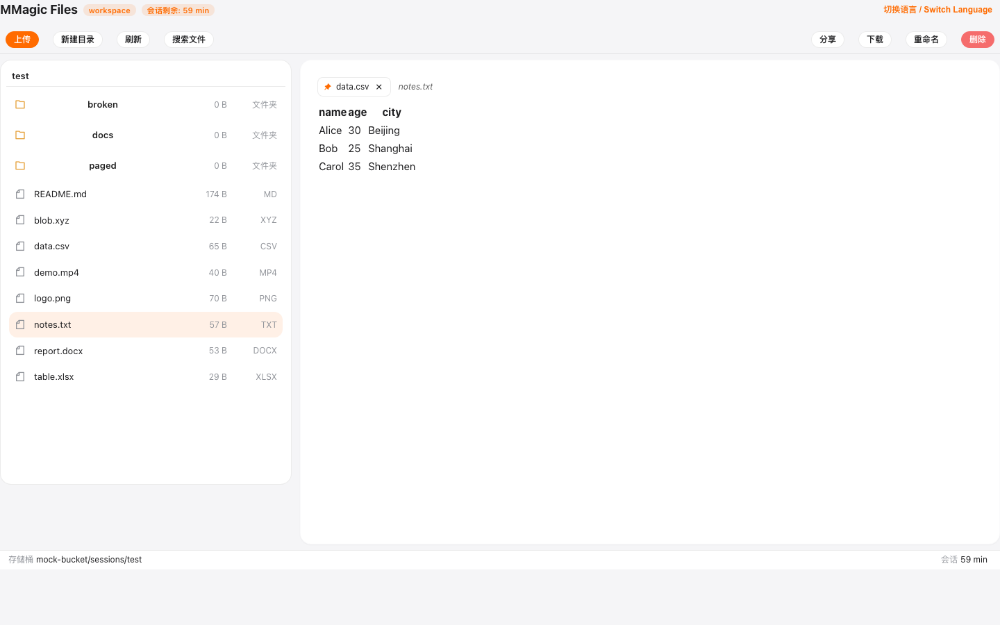 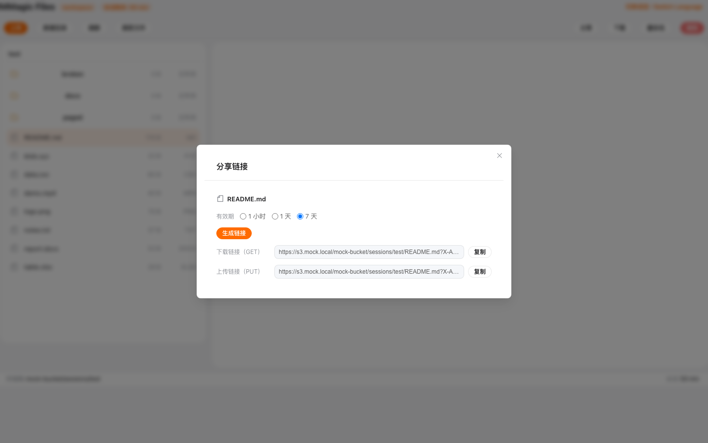 |
| — | **合计** | **42** | **42（100%）** | 其余截图见 `./screenshots/`（59 张套件 + 20 张探针） |

### 逐用例结果（末轮全量，耗时为单用例实跑）

| 线 | 用例 | 结果 | 耗时 |
| --- | --- | --- | --- |
| 0 | warmup：预热重依赖并留存工作台基线截图 | ✅ | 1.9s |
| 1 | boot-01 无 fragment → 4001 / boot-02 坏 JSON → 4001 / boot-03 v=2 → 4001 | ✅✅✅ | 0.3s / 0.4s / 0.3s |
| 2 | ws-01 树渲染 / ws-02 子目录+面包屑 / ws-03 聚合翻页 / ws-04 List 500→重试恢复 | ✅✅✅✅ | 0.4s / 0.5s / 0.5s / 0.5s |
| 3 | render-01 md / render-02 png / render-03 csv 默认表格（F3）/ render-03b Monaco 不抢占（F3）/ render-04 txt Monaco 舞台达标（F5）/ render-05 mp4 / render-06 fallback / render-07 错误边界 | ✅×8 | 0.4~0.7s |
| 4 | tb-01 新建目录 / tb-02 删除 / tb-03 重命名 / tb-04 刷新 | ✅×4 | 0.4~1.1s |
| 5 | up-01 上传+树自动刷新（F6）/ up-02 扩展名拒 / up-03 大小拒 / up-04 重名冲突跳过/覆盖（**新增**） | ✅×4 | 0.4~1.6s |
| 6 | sess-01 到期遮罩 / sess-02 到期后命令回 5000（F4） | ✅✅ | 5.8s ×2 |
| 7 | feat-01 API 4301 / feat-02 按钮隐藏（F1）/ feat-03 UI 整链拒绝（F1） | ✅×3 | 0.4~1.9s |
| 8 | file-01 只读渲染源内容（F2）/ file-02 可编辑标记 | ✅✅ | 0.5s |
| 9 | office-01 docx 损坏降级 / office-02 xlsx 双 sheet 切换 | ✅✅ | 0.4~0.5s |
| 10 | plug-01 不可达 4201 / plug-02 SRI 不符 4201 | ✅✅ | ~0.5s |
| 11 | wb-01 右键菜单+open-with / wb-02 拖拽上传 / wb-03 多选批量删除 / wb-04 取消 / wb-05 粘贴上传 / wb-06 预览 tab 钉住（**新增**）/ wb-07 分享链接（**新增**） | ✅×7 | 0.6~2.0s |

---

## ④ 新功能取证补拍（探针实测，13 组 / 20 张）

> 探针脚本：`/tmp/mmf-probe/`（副本在 `./artifacts/probe-scripts/`），真实 dev server（vite 5199）+ S3 Mock，只交互截图、不断言产品行为。13/13 通过。运行日志 `./artifacts/probe-run.log`。

| # | 场景 | 结论 | 截图 |
| --- | --- | --- | --- |
| ① | 工作台全景（树+分页器+预览 tab+StatusBar+传输中心） | 各区块同屏齐活：左侧 120 文件深目录出分页条（1/2）；预览区 notes.txt（已钉住）+ data.csv 双 tab；底部传输任务条（pano.txt 0% 上传中，暂停/取消钮）；最底 StatusBar（存储桶路径 / 传输任务 1 / 会话 59 min） |  |
| ② | 全局搜索 | 冷索引查询「md」→「无匹配结果」空态（**R2-07**）；点「扫描当前前缀」后索引计数出现（截图时 8，扫描进行中），结果行出现（README.md + 打开/定位目录钮） |   |
| ③ | 分享对话框 | 选中 README.md → 分享 → 生成链接 → GET/PUT 两条预签名 URL（含 X-Amz-Signature，探针日志有全文）+ 复制钮 + 有效期 1 小时/1 天/7 天单选 |  |
| ④ | 预览 tab 钉住 | 预览态打开第二个文件会**原位替换**（不钉住不并存——与 wb-06 契约一致）；双击 tab 钉住后两 tab 并存、钉住图钉标显示 |  |
| ⑤ | 传输中心暂停/恢复 | 并发 3 + 4 任务：slow-1~3 上传中、slow-4 排队 → 暂停 →「已暂停 + 继续」→ 恢复 → 4 条全部「已完成」；StatusBar 传输任务数同步（4） |  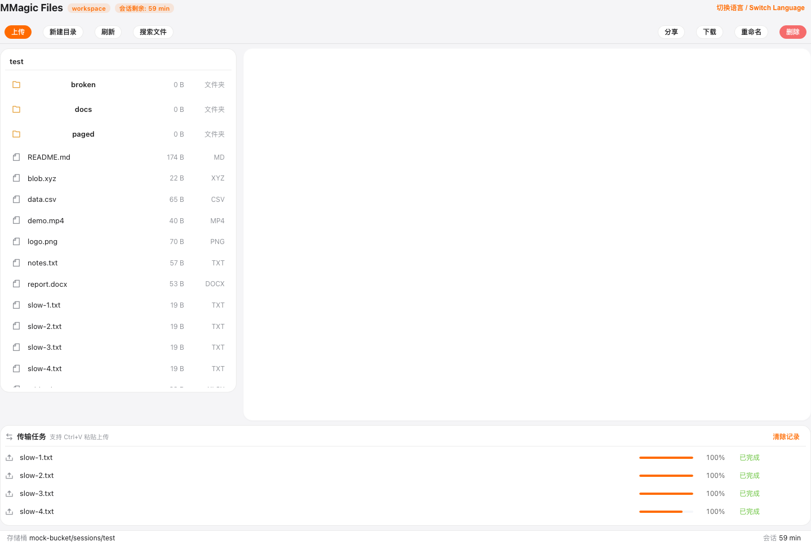 |
| ⑥ | 命令面板 ⌘K | **⌘K / Ctrl+K 均无响应**（.fc-cp 面板数=0）——mod+k 唯一绑定在从未挂载的 AppLayout（**R2-01 P1**） |  |
| ⑦ | boot 失败卡 + 连接向导 | 无 fragment → 配置错误卡（code=4001 · URL fragment 缺配置）+「连接到 S3」入口；向导表单字段齐全（配置名称/Endpoint/Region/Bucket/AccessKeyId(密文+可见性切换)/SecretAccessKey/根目录前缀/会话时长/path-style 开关/测试连接/连接/保存配置/凭据 localStorage 警告）；**但弹窗打开后错误卡大标题文字叠在弹窗上层（R2-02 P2）** |   |
| ⑧ | 键盘流 Alt+↑ | 在 docs/ 目录聚焦列表按 Alt+↑ → 回到根目录（面包屑 test），目录行选中态保留 |   |
| ⑨ | 上传冲突对话框 | 重名上传 →「文件名冲突 / 目标目录已存在 1 个同名文件：notes.txt」，可见按钮只有 跳过/覆盖 两个 + 右上角 X；词典键 `transfer.conflict-abort`（取消上传）从未渲染（**R2-04**） |  |
| ⑩ | 深目录分页条 | deep/ 120 条 → 分页条（« ‹ 1/2 › » + 跳页输入），第 1 页恰 100 行；跳页输 2 回车 → 第 2 页 20 行 |  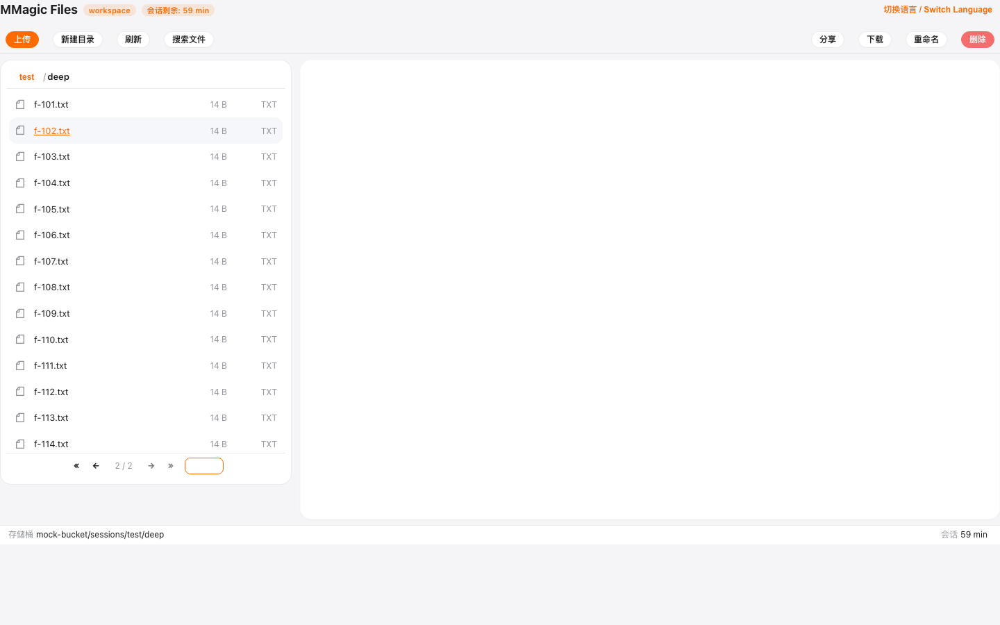 |
| ⑪ | 大文件分级闸（csv 双闸叠加） | 25.1MB csv：先弹「文件较大（25.1MB）…是否继续？」→ 确认放行 → **仍被 csv 渲染器「CSV 过大（>20MB）」拒绝**（**R2-03 P2**，确认白点） |   |
| ⑫ | markdown 5MB 闸 | 6.3 MB .md：无确认环节，直接「文档过大（>5MB），请下载后查看」；与树列「6.3 MB」、确认框「25.1MB」、词典「>5MB/>20MB/>50MB」并存——单位格式三种口径（**R2-05**） |  |
| ⑬ | painter（svg 保存） | icon.svg 右键「打开方式▸图片标注」→ canvas 加载底图 + 工具条（笔刷/2/5/10/清空/保存）→ 保存 → PUT 原 key `sessions/test/icon.svg`（PNG 字节），**全程无「svg 将以 PNG 位图保存」提示**（**R2-08**）；工具条为原生未样式化按钮（R2-12） |   |

---

## ⑤ 缺陷与修复意见清单（只记录，未改码）

> 严重度：P0=主流程不可用/权限失效；P1=承诺功能实际不可用；P2=可感知缺陷/口径偏差；P3=体验/一致性细节。
> 与上轮挂账的关系在每条末尾标注。**本轮 0 处代码改动。**

### R2-01（P1）⌘K 命令面板在真实 UI 中无法唤起——唯一快捷键绑定在从未挂载的 AppLayout 上

- **现象**：工作台内按 ⌘K（macOS）和 Ctrl+K 均无任何反应，`.fc-cp` 面板 DOM 数量=0（探针 console 证据 `[probe-06] ⌘K/Ctrl+K 后 .fc-cp 面板数量 = 0`）。命令面板组件（FcCommandPalette）挂在 `App.vue`，但**全项目唯一唤起入口** `useKeyboardShortcut('mod+k', openCommandPalette)` 写在 `src/layout/AppLayout.vue:108`，而路由表（`src/router/index.ts`）只有 Home 一条路由、`App.vue` 也不渲染 AppLayout——AppLayout 是死代码，面板因此没有任何可达入口。双模式（文件模式/`>` 命令模式）、命令清单、最近使用排序等能力全部连带不可达。
- **证据**：（按完 ⌘K+Ctrl+K 后工作台无任何变化）；静态核对 `App.vue:63` 注释自述「全局绑定在 AppLayout…保持不变」，但该前提不成立。
- **建议修法**：把 `useKeyboardShortcut('mod+k', () => openCommandPalette())` 上移到 `App.vue`（与 FcCommandPalette 同处）；顺带在面板命令清单补「打开传输面板」（见挂账③）。加一条 E2E：⌘K 后 `.fc-cp` 可见。
- **关联挂账**：挂账③「命令入口传输不进面板」的**前置条件即本条**——面板本身先打不开；静态核对 Home 注册的命令清单（cmd:search/refresh/goto-root/toggle-locale，`Home.vue` 命令面板数据源段）确实没有传输面板相关命令，两项合并跟踪。

### R2-02（P2）boot 页打开连接向导后，错误卡标题/文字叠在弹窗上层（视觉穿透）

- **现象**：无 fragment 进入 boot 错误卡 → 点「连接到 S3」打开向导弹窗，错误卡的 h1 大标题「配置解析失败…」、code=4001 行、按钮文字渲染在弹窗遮罩**之上**，与表单文字互相叠压，观感明显破损。
- **证据**：（对照正常层级的错误卡 ）
- **根因方向**：`.home-hero` 卡片内容创建了更高/更后的 stacking context（h1 无 z-index 但 DOM 顺序/transform 等使其盖过 FcDialog 的 overlay），需查 `.home-hero__title` 与 FcDialog 遮罩的 z-index 层级。
- **建议修法**：给 FcDialog 遮罩统一高 z-index（高于任何页面内容），或排查 hero 卡上导致层叠上下文失效的样式（transform/opacity/filter）。
- **关联挂账**：无（本轮新发现）。

### R2-03（P2）大文件「分级闸」与渲染器限额两道闸叠加——20~50MB 的 csv 用户确认后仍被拒，确认动作白做

- **现象**：25.1MB 的 .csv 打开：先过预览闸（20<25.1≤50MB）弹确认，用户点「确认」放行后，csv-table 渲染器按自身 20MB 限额直接拒绝，最终仍看不到内容。用户被问了一次「是否继续」却没有获得任何能力。对比：6.3MB 的 .md 不经确认直接被 markdown 渲染器 5MB 限额拒掉（连闸都不过）——闸的分层语义不一致：预览闸不知晓下游渲染器限额，渲染器限额也不复用预览闸的结论。
- **证据**： → ；；代码：`files/preview.ts`（PREVIEW_CONFIRM_BYTES=20MB / PREVIEW_REJECT_BYTES=50MB）vs `apps/renderers/csv.ts`（CSV_MAX_BYTES=20MB）vs `apps/renderers/markdown.ts`（MAX_BYTES=5MB）。
- **建议修法**：把各渲染器的字节限额登记到 registry（如 spec 加 `maxBytes`），预览闸取 `min(PREVIEW_REJECT, 渲染器限额)` 作为该类型实际拒绝线、`max(渲染器限额, CONFIRM)` 以下不再询问；或至少：渲染器限额 ≤ 预览确认线的类型跳过确认直接给「过大请下载」拒绝节点，避免「确认后仍拒」。
- **关联挂账**：挂账①「csv 双闸叠加」**实测成立**。

### R2-04（P2）上传冲突对话框第三态「取消上传」无可见按钮——词典键 transfer.conflict-abort 死键

- **现象**：冲突对话框可见按钮只有「跳过」「覆盖」两个 + 右上角裸 X。代码注释声称「三按钮口径：覆盖/跳过/关闭=整批取消」，第三态实际由 `distinguishCancelAndClose` 的 X 承载，但 X 无文字、无 tooltip，用户不可能知道 X=取消整批；为第三态准备的文案 `transfer.conflict-abort`（「取消上传」）在 zh-CN/en-US 词典中都存在却从未被任何组件引用。
- **证据**：（探针 console：`按钮 = ["跳过","覆盖"]`）；静态核对 `Home.vue confirmConflict()` 与 locales。
- **建议修法**：ElMessageBox 不可放三钮的话，至少给 X 加 `tooltip=取消上传`（用上 conflict-abort 键）；或改用自绘/FcConfirm 实现真三钮。
- **关联挂账**：挂账④「transfer.conflict-abort 死键」**成立**。

### R2-05（P2）文件大小单位/格式三种口径并存

- **现象**：同一屏体系内：树列表「6.3 MB / 174 B」（有空格、B 独立）→ 大文件确认框「25.1MB」（无空格）→ 拒绝文案「>5MB / >20MB / >50MB」（硬编码在词典）。
- **证据**：（左树 6.3 MB + 文案 >5MB 同屏）、（25.1MB）。
- **建议修法**：统一走一个 `formatBytes` 口径（建议「数值+空格+单位」如 `25.1 MB`），词典里的 >5MB/>20MB/>50MB 改为 `{limit}` 占位传入 formatLimit；顺带统一 MB=1024² 的口径注释。
- **关联挂账**：挂账②「5MB 单位不统一」**成立**（且不止 5MB 一处）。

### R2-06（P2）构建主包 4.07MB（gzip 1.05MB）——manualChunks 收敛挂账仍在

- **现象**：`pnpm build` 主 chunk `index-CIKMI5h4.js` 4,075.46 kB（gzip 1,050.97 kB），vite >1100kB 警告；首屏需下载解析整个主包。
- **证据**：本轮构建输出（附录 ② 门禁表⑤）；`vite.config.ts` manualChunks 现状。
- **建议修法**：monaco-editor、mermaid、katex、cytoscape(elk)、heic2any、docx-preview、pdfjs 等已动态导入的重依赖继续拆离后，主包里剩下的 element-plus + 业务代码建议按路由/域再拆（Home 工作台 vs SDK 通道），并把 `chunkSizeWarningLimit` 的报警真正消化而不是调阈值。
- **关联挂账**：挂账⑥「manualChunks 主包 4MB」**成立**（实测 4075.46 kB）。

### R2-07（P3）搜索/命令面板冷启动空结果，无「先扫描」引导

- **现象**：未扫描时搜索面板查任意词都是「无匹配结果」空态，只有底部一行小字「索引范围：已扫描的对象元数据…」暗示要先扫描；命令面板文件模式同理（静态核对：`registerFileSearchProvider` 注释明写「未扫描=空结果」）。用户第一观感是「搜不到」而非「还没建索引」。
- **证据**：。
- **建议修法**：空态文案改「索引为空，点击『扫描当前前缀』建立索引」并放行动按钮；或进工作台后台低优先级自动预热扫描（对齐 Google Drive「搜索即用」预期）。
- **关联挂账**：挂账⑦「search 索引冷启动为空」**成立**。

### R2-08（P3）painter 保存 svg 时静默转 PNG——无任何用户提示

- **现象**：icon.svg 用「图片标注」打开 → 保存 → PUT 回原 key（PNG 位图字节、仍是 .svg 扩名），全程无「svg 将以 PNG 格式保存」的 toast 或对话框；后续真实渲染器若按 svg 解析该文件将失败。代码里 `pickExportFormat` 注释自认「降级 PNG 并在此留痕」，但只留在代码注释。
- **证据**： ；探针 console `putRequests = ["sessions/test/icon.svg"]`；`apps/renderers/painter.ts`。
- **建议修法**：保存前检测 `pickExportFormat` 发生了 mime 降级（原扩展 ≠ 导出 mime）时弹确认或 toast「画板导出为 PNG 位图，将覆盖原 svg 文件」。
- **关联挂账**：挂账⑧「painter svg 存后变 PNG 提示缺失」**成立**。

### R2-09（P3）lint 警告 8 处（PreviewTabs 1 / StatusBar 2 / AppLayout 5）

- **现象**：`pnpm lint` 0 error 但 8 个 `local/prefer-fc-button` 警告：`PreviewTabs.vue:119`、`StatusBar.vue:89,108`、`AppLayout.vue:174,188,267,276,311`。均为业务代码裸 `<button>` 未用 FcButton/fc-button-*。
- **证据**：本轮 lint 输出（门禁表②）；静态核对。
- **建议修法**：替换为 FcButton 或补 fc-button 类；AppLayout 若确认死代码（见 R2-01），修复前先决定其去留。
- **关联挂账**：挂账⑤「PreviewTabs lint 警告」**成立**，且新增 StatusBar/AppLayout 同类共 7 处。

### R2-10（P3）已暂停的上传任务仍渲染灰显「暂停」按钮

- **现象**：任务进入「已暂停」后，行内仍显示禁用态的「暂停」钮 +「继续」钮并列，视觉噪音；模板 `v-if="status==='uploading' || status==='paused'"` 对暂停钮过宽。
- **证据**：（slow-4 行：暂停(灰)+继续+取消）。
- **建议修法**：暂停钮 `v-if` 收敛为仅 uploading；或按状态渲染单一动作钮（上传中→暂停 / 已暂停→继续）。
- **关联挂账**：无（新发现）。

### R2-11（P3）ElMessageBox 确认按钮为 Element 默认蓝，与品牌主色（橙）不一致

- **现象**：冲突/大文件确认等 ElMessageBox 的主按钮是 Element Plus 默认蓝（#409eff），而工作台按钮体系（FcButton/上传钮等）是品牌橙；同一操作链上两种「主色」。
- **证据**： 。
- **建议修法**：给 ElMessageBox 的 confirmButtonText 按钮统一下沉品牌样式（全局覆盖 .el-message-box__btns .el-button--primary 主色），或统一改走 FcConfirm。
- **关联挂账**：无（新发现）。

### R2-12（P3）painter 工具条为原生未样式化按钮

- **现象**：画板工具条（笔刷粗细 2/5/10、清空、保存）是浏览器默认样式的原生 `<button>`，与整体 UI 风格脱节（组件注释自认「待主词典补录/样式待补」欠账）。
- **证据**：（左上角一排原生小按钮）。
- **建议修法**：套 FcButton/fc-button-* + 图标；与 R2-09 一并处理。
- **关联挂账**：无（新发现）。

### R2-13（P3）csv-table 表格视图无边框/网格线，观感近似纯文本

- **现象**：csv 打开的「表格视图」实际渲染为无边框、无斑马纹、无固定表头的松散行列（name age city / Alice 30 Beijing…），与「表格」命名预期不符；列宽不齐时数据列难对齐。
- **证据**：（预览区 data.csv）。
- **建议修法**：加网格线/表头底色/行 hover（已有行 hover 的话补边框），列内容右对齐数字列。
- **关联挂账**：无（新发现，观感类）。

### R2-14（P3）搜索结果修改时间未按 locale 格式化（zh-CN 显示 en-US 格式）

- **现象**：zh-CN 环境下搜索结果的时间列显示「10/1/2026, 8:00:00 AM」（`toLocaleString()` 缺省 locale），与全站中文文案不符。
- **证据**：。
- **建议修法**：`toLocaleString(i18n.global.locale.value, …)` 或统一 `Intl.DateTimeFormat('zh-CN', …)`。
- **关联挂账**：无（新发现）。

### 缺陷分级统计

| 级别 | 数量 | 编号 |
| --- | --- | --- |
| P0 | 0 | — |
| P1 | 1 | R2-01 |
| P2 | 5 | R2-02、R2-03、R2-04、R2-05、R2-06 |
| P3 | 8 | R2-07 ~ R2-14 |
| 合计 | 14 | 全部只记录、未改码 |

### 已知挂账核对（8 项全部核销）

| 挂账 | 结论 | 对应 |
| --- | --- | --- |
| csv 双闸叠加（20~50MB 确认后仍被 csv 渲染器 20MB 拒） | ✅ 实测成立 | R2-03 |
| 「5MB」单位不统一 | ✅ 成立（三种口径并存） | R2-05 |
| 命令入口传输不进面板 | ⚠️ 前置更严重：面板本身无入口；命令清单静态核对确无传输项 | R2-01 |
| transfer.conflict-abort 死键 | ✅ 成立 | R2-04 |
| PreviewTabs lint 警告 | ✅ 成立（另有 StatusBar/AppLayout 同类 7 处） | R2-09 |
| manualChunks 主包 4MB | ✅ 成立（4075.46 kB） | R2-06 |
| search 索引冷启动为空 | ✅ 成立（搜索面板实测 + 命令面板静态） | R2-07 |
| painter svg 存后变 PNG 提示缺失 | ✅ 成立 | R2-08 |

---

## ⑥ 与上轮缺陷（F1~F6）回归核对——全部保持闭合

| 编号 | 缺陷 | 本轮验证用例 | 状态 |
| --- | --- | --- | --- |
| F1 | features.delete=false 时 UI 整链绕过门控 | feat-01（API 4301）/ feat-02（删除按钮不渲染）/ feat-03（无 S3 删除） | ✅ 仍闭合 |
| F2 | 单文件 #file 不渲染内容 | file-01（GET=1 且 markdown 渲染） | ✅ 仍闭合 |
| F3 | .csv 默认应用被 code-editor 抢占 | render-03（csv-table 默认）/ render-03b（Monaco 不抢占） | ✅ 仍闭合 |
| F4 | 到期后命令无回包（契约 5000） | sess-02（reply ok=false code=5000） | ✅ 仍闭合 |
| F5 | Monaco 预览容器塌陷 5×5px | render-04（舞台尺寸达标断言在测） | ✅ 仍闭合 |
| F6 | 上传完成后树不自动刷新 | up-01（树自动刷新出现新文件） | ✅ 仍闭合 |

---

## ⑦ 附录

### 环境

| 项 | 值 |
| --- | --- |
| 机器/系统 | macOS Darwin 25.5.0（arm64） |
| Node / 包管理 | Node v26.0.0 / pnpm 9.12.0 |
| Playwright / 浏览器 | @playwright/test 1.64.0 / Chromium 156.0.8078.4（chromium v1248 + headless-shell，本轮经 npmmirror 重装，系统钥匙串 CA 以 NODE_EXTRA_CA_CERTS 过企业 TLS 中间人） |
| 被测服务 | `pnpm exec vite --port 5199 --strictPort`（BROWSER=none）；主套件由 playwright webServer 自起复用，探针复用同一实例 |
| 代码基线 | commit `33853d9`（main），`frontend/` 工作区干净 |
| 视口 | 1440×900（截图另含 fullPage） |

### 耗时

| 项 | 耗时 |
| --- | --- |
| typecheck | <1min（exit 0） |
| lint | 秒级（0e/8w） |
| vitest run | 9.86s |
| playwright 全量（42） | 45.0s（墙钟 45.7s，含 webServer 复用） |
| build | vite build 19.94s（墙钟 25.0s） |
| 探针 13 组 | 27.3s |

### 产物清单

| 路径 | 说明 |
| --- | --- |
| `test-report/2026-10-09-02/回归测试报告.md` | 本报告 |
| `test-report/2026-10-09-02/优化建议-大厂对标实测.md` | 配套走查建议（独立文档） |
| `test-report/2026-10-09-02/playwright-run.log` | 主套件末轮全量原始日志（42/42） |
| `test-report/2026-10-09-02/screenshots/`（79 张） | 套件证据 59 张（自 01 复制归档）+ 探针取证 20 张 |
| `test-report/2026-10-09-02/artifacts/probe-run.log` | 探针运行日志（含 console 证据：index-count、分享 URL、冲突按钮、painter PUT、⌘K 计数） |
| `test-report/2026-10-09-02/artifacts/probe-scripts/` | 探针脚本副本（/tmp/mmf-probe/ 的归档，供复现） |
| `frontend/playwright.config.ts`、`frontend/e2e/` | 未改动（本轮 0 行变更） |

### 与 01 归档的关系说明

- 套件截图按既有流程刷新在 `2026-10-09-01/screenshots/`（同名文件、内容为本轮实拍，7 张字节级更新：fix-upload-tree-autorefresh / render-05-video / up-01b / up-04b / ws-04a/b/c，多为含时间要素的 toast/视频帧，属正常差异）；git 跟踪的 01 归档内容未删除任何文件，01/artifacts 保持原状。
- 本轮 e2e 0 失败，`2026-10-09-02/artifacts/` 无失败 trace 归档项；「fail 完整证据原则」本轮无触发对象（探针调试期产生的临时失败痕迹均在 /tmp，未混入归档）。
