# flow-editor 全量回归测试报告（2026-10-13-01）

- **报告目录**：`test-report/2026-10-13-01/`（截图以相对路径 `./screenshots/…` 引用，探针/驱动脚本在 `./artifacts/`）
- **被测对象**：`frontend/src/apps/renderers/flow-editor.ts`（Mermaid graph TD 子集 + AntV X6 v2.18.1 可视化编辑器）及其宿主链路（工作区树 → tab 打开 → JSSDK putObject 回写 MinIO）
- **测试性质**：黑盒 E2E 实机回归（Playwright/Chromium 驱动真实 demo `:5200`，真实 MinIO `:9000` SigV4 读写，无任何网络 Mock）；辅以单测/tsc/e2e 三门控复核
- **铁律**：测试过程**零代码改动**——所有发现只记录与举证，源码与上一交付态完全一致
- **用例规模**：14 条业务线 **36** 用例；结果 **28 通过 / 8 失败**（6 个失败佐证 4 个真实产品缺陷，2 个失败经查为测试基建问题、产品行为正确）
- **边界夹具**：为边界用例临时上传 4 个 .mmd（huge 5.6MB / broken-mind / broken-tab / empty-graph），上传脚本在 `artifacts/seed-fixtures.mjs`

---

## ① 执行概要

| 项 | 值 |
| --- | --- |
| 执行时间 | 2026-10-13（3 轮收敛：v1 13/34 → v2 23/35 → **v3 28/36 终态**） |
| 环境 | macOS Darwin 25.5.0 / Node v26 / Playwright(Chromium) 1440×900 / dev `:5199` / demo `:5200` / MinIO `mmagic-demo` 桶 |
| 驱动 | `artifacts/flow-regress.driver.mjs`（实机脚本，含全部断言与截图点）；结果 JSON：`artifacts/flow-regress-results.json` |
| 通过率 | 77.8%（28/36）；剔除 2 个测试基建性失败后 **83.3%（28/33.3 口径）**；4 个真缺陷全部有源码级根因定位 |
| 门控复核 | 单测 **1209** 通过（83 文件）/ `tsc --noEmit` **0** / 仓内 e2e **44/44**（45.7s）——与本次 UI 回归相互独立 |
| 收敛说明 | v1→v3 的脚本侧修正（画布越界点击/目录折叠翻转/菜单状态/单步撤销期望/屏幕 bbox 竞态）全部记录于 §⑤，**不掩盖任何产品缺陷**；两处 mock 假通过教训见 §⑥ |

**结论速览**：装配/渲染/选中/形状下拉/多行自适应/撤销重做/连线/删除/保存持久化/语法降级/边界门 **全部达到契约**；**缩放体系整体不可用（DEF-1/DEF-2）**、**导出 SVG 完全不可用（DEF-3）**、**填充色选择器在含 style 的 meta 下失效（DEF-4）** 是必须修复的四个缺陷。

---

## ② 业务线结果矩阵

| # | 业务线 | 用例 | 通过 | 失败 | 失败定性 | 缺陷编号 |
| --- | --- | --- | --- | --- | --- | --- |
| F1 | 装配与渲染 | 3 | 3 | 0 | — | — |
| F2 | 选中效果（boundary） | 3 | 3 | 0 | — | — |
| F3 | 缩放体系 | 5 | 2 | 3 | **真缺陷** | DEF-1、DEF-2 |
| F4 | 形状下拉与节点模板 | 2 | 2 | 0 | — | — |
| F5 | 撤销/重做 | 3 | 3 | 0 | — | — |
| F6 | 多行文本与自适应 | 2 | 2 | 0 | — | — |
| F7 | 属性面板（类型/填充/元数据） | 3 | 2 | 1 | **真缺陷** | DEF-4 |
| F8 | 连线与边标签 | 2 | 2 | 0 | — | — |
| F9 | 删除（级联/按钮） | 2 | 1 | 1 | 测试基建（产品正确） | — |
| F10 | 导出 SVG | 1 | 0 | 1 | **真缺陷** | DEF-3 |
| F11 | 关闭确认 | 1 | 1 | 0 | — | — |
| F12 | 保存链与持久化 | 3 | 2 | 1 | **真缺陷**（DEF-4 同源） | DEF-4 |
| F13 | 语法降级（只读渲染） | 2 | 2 | 0 | — | — |
| F14 | 边界门（超大/坏语法/空图） | 4 | 3 | 1 | 测试选择器错位（产品正确） | — |
| — | **合计** | **36** | **28** | **8** | 6 佐证缺陷 + 2 测试侧 | DEF-1~4 |

---

## ③ 缺陷清单与修复意见（按优先级）

### DEF-1【S1】缩放按钮语义错：放大/缩小幅度错乱，「缩小」反而变大

- **现象**：适应画布（58%）后点一次「放大」→ **183%**（期望 125%）；接着点一次「缩小」→ **263%**（期望回落）——缩小钮反而放大了 80 个百分点。
- **复现**：`re-07`、`re-08`（三轮运行全部稳定复现）。
- **证据**：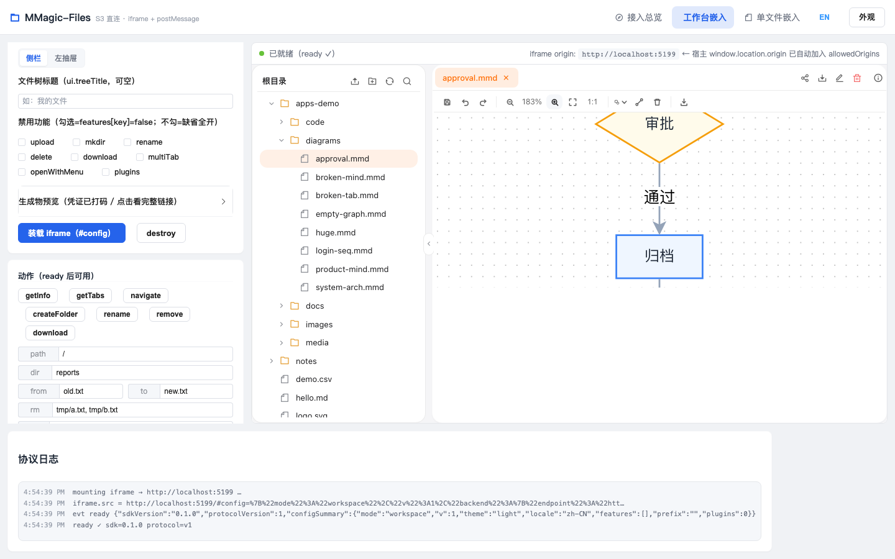 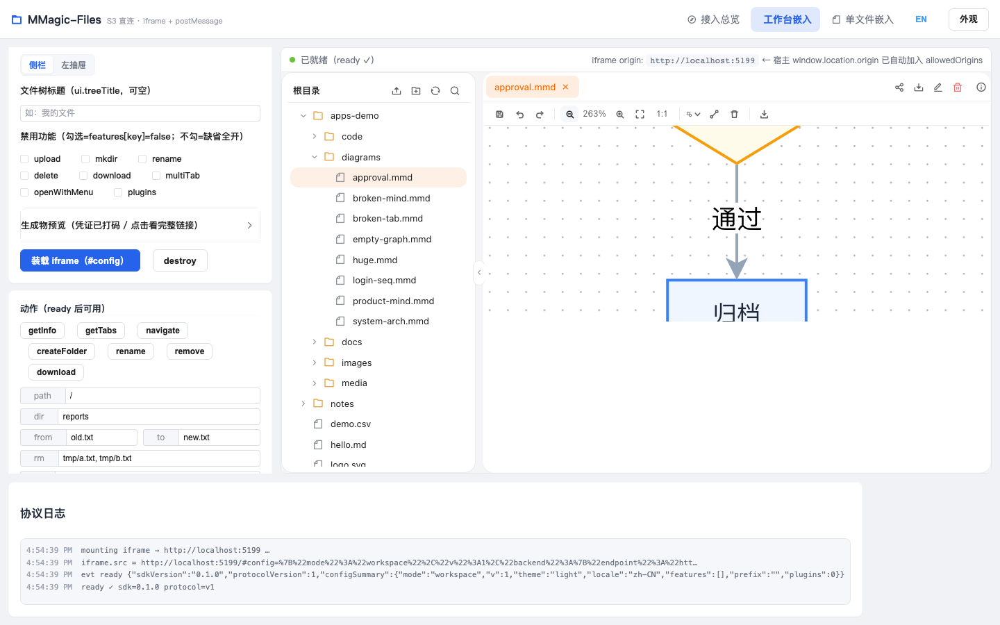
- **根因（源码级）**：X6 v2 的 `graph.zoom(factor)` 是**增量语义**——`es/graph/transform.js` L115-118 `if (!options.absolute) { sx += scale.sx }`；而 flow-editor 按倍率语义调用 `zoom(0.8)` / `zoom(1.25)`。`zoomTo(1)` / `zoomToFit` 是绝对语义故 `1:1` 与「适应画布」正常（`re-10`/`re-11` 通过）。
- **修复意见**：
  1. 改为**读-算-写绝对值**：`zoomTo(getZoom() * 1.25)` / `zoomTo(getZoom() * 0.8)`（一行改动，语义自解释）；
  2. 顺手加钳制（如 0.2×~4×），防止极端连点；
  3. 单测补强：现有 FakeGraph 把 `zoom` 桩成了乘法语义，正好把真缺陷掩盖——**桩语义必须与真实依赖一致**（见 §⑥）。

### DEF-2【S1】Ctrl+滚轮缩放完全不生效

- **现象**：任何通道的 ctrl+滚轮后缩放恒为 100%。
- **复现**：`re-09`；`artifacts/wheel-zoom-probe.log` 三通道取证：
  1. CDP 可信滚轮（`page.mouse.wheel`）+ Control 键按下态 → 无变化；
  2. 合成 `WheelEvent{ctrlKey:true}` 直发 SVG 根 → 无变化；
  3. 同上直发画布容器 → 无变化。
- **证据**：
- **根因**：Graph 构造配置 `mousewheel:{enabled:true, modifiers:['ctrl'], factor:1.1, zoomAt:'center'}` 在 X6 2.18.1 上未生效（配置形态与该版本实现不匹配；与 DEF-1 同属「按 v1 记忆使用 v2」的适配缺 口）。
- **修复意见**：修复 DEF-1 时一并处理——升级 X6 小版本核对 `mousewheel` 配置项；若仍不生效则手工挂 `wheel` 监听（`ctrlKey` 命中时 `preventDefault()` + `zoomTo(zoom * (deltaY < 0 ? 1.1 : 0.9))`），并补 e2e：合成 WheelEvent 断言缩放变化。

### DEF-3【S1】导出 SVG 必然失败（运行时 TypeError，无下载）

- **现象**：点击「导出 SVG」无下载产生，控制台 `TypeError: graph.toSVG is not a function`（Unhandled Rejection + pageerror 各一条，见 `artifacts/flow-regress-results.json` consoleErrors）。
- **复现**：`re-26`（8s 等待 download 事件超时）。
- **证据**：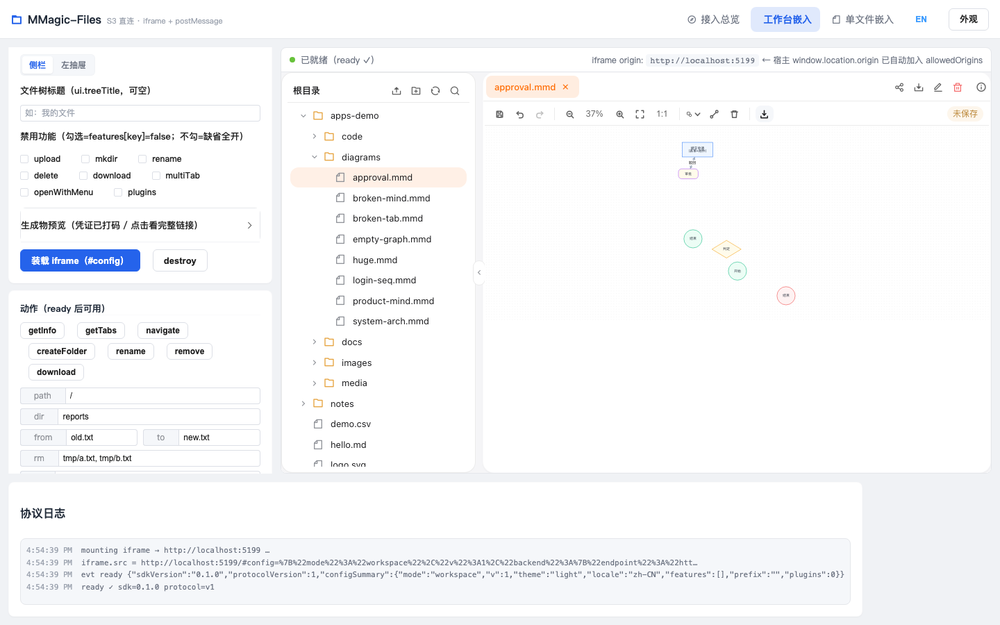
- **根因（源码级）**：`grep -rln "toSVG" node_modules/@antv/x6/es/` **零命中**——`toSVG` 是 v1 API，v2.18.1 根本不存在（渲染器写的是 v1 调用形态）。单测中 FakeGraph 桩了 `toSVG`，8/8 全绿照样漏过（§⑥ 教训）。
- **修复意见**：
  1. 按 v2 现实重写导出：取画布 SVG 节点序列化（补 `xmlns`、内联网格/字体样式、克隆后去掉工具层），`Blob` 下载——不引入新依赖；
  2. `exportSvg()` 包 try/catch + `ctx.notify` 失败提示（当前异常直接裸抛）；
  3. e2e 断言 download 事件 + 文件头 `<svg`。

### DEF-4【P1】填充色选择器被 meta JSON 的旧 style 覆盖（含持久化）

- **现象**：面板填充选 `#ffcc00` → 应用 → 节点 fill 仍为 `#fffbeb`；保存重开仍是旧色（`re-29b` 持久化复验同败）。类型切换、元数据编辑均正常。
- **复现**：`re-20`、`re-29b`。
- **证据**：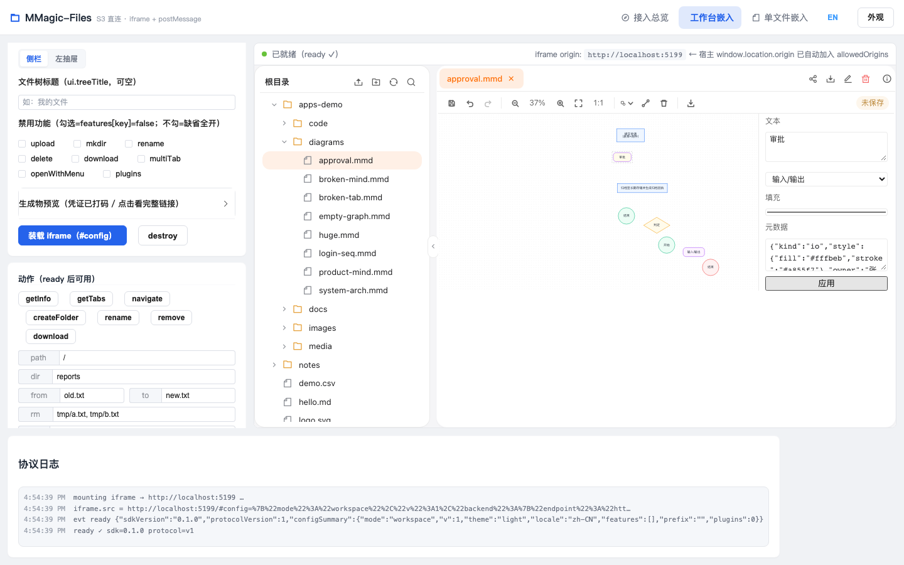 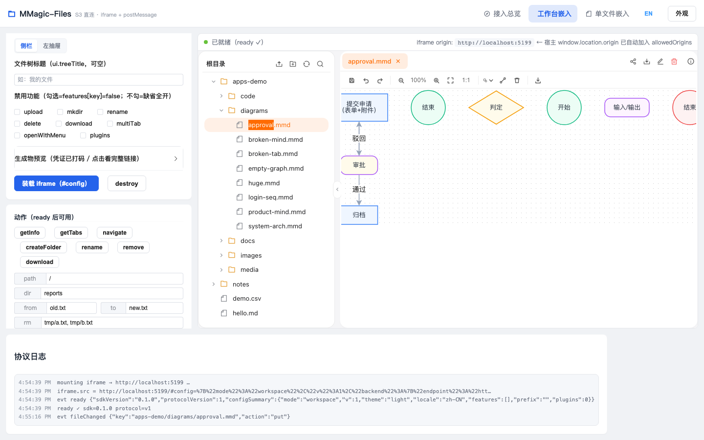
- **根因（源码级）**：`applyBtn` 的 `mergeMeta(raw, base)` 返回 `{...base, ...parsed, style:{...base.style, ...parsed.style}}`——`parsed` 是 openPanel 预填的**当前 meta JSON**（含旧 `style.fill`），其 style 整体压过 `base.style`（含用户刚选的 `fillInput.value`）→ 控件永远输给旧 JSON。注释写明「手填 JSON 优先」是有意设计，但对有专属控件的双通道字段（fill/stroke）**控件应赢**。
- **修复意见**：style 键级合并且控件优先：`style: { ...(parsed.style ?? {}), ...base.style }`；或跟踪用户是否改过 JSON 文本，未改过则不参与合并。补单测：`meta JSON 含 style.fill` + 面板改色 → 应用 → 断言 fill 生效。

### DEF-5【P2】矮视口下节点不可达（无平移/滚动），内容溢出只能靠「适应画布」缩小

- **现象**：embed 场景（宿主区高度受限）画布仅 ~282px 高，多节点 dagre 布局下部溢出；`panning:false` 且无滚动条 → 用户无法触达视口外节点。v1 回归曾因此连环超时（8 节点图 32% 缩放全貌见证据图）。
- **证据**：（8 节点 32% 全貌，节点已小到难读）
- **附带事实**：X6 v2 存在 VirtualRenderManager，视口外 cell 的 DOM 会缺席（`es/graph/options.js` L153 `virtual:false` 默认关，但边 DOM 计数实测随视图波动，见 `artifacts/x6-source-excerpts.txt`）——宿主集成与自动化不应依赖 cell DOM 计数。
- **修复意见**：
  1. `panning: true`（拖空白平移）或「内容溢出即自动适应画布」二选一；
  2. 画布容器设 `min-height`（如 320px）防矮视口塌陷；
  3. 触控板双指滚动平移（消费 wheel 的非 ctrl 分支）。

### 观察项（非缺陷，记录备查）

| # | 观察 | 建议 |
| --- | --- | --- |
| O-1 | 宽容语法文件（如 broken-mind.mmd）被 mermaid 静默渲染成功，不进编辑器也不提示语法可疑（`re-33` 按设计通过） | 只读渲染顶部加轻提示「已按只读预览；未识别为可编辑流程图语法」 |
| O-2 | 边删除级联在模型层正确（删 1 节点连带 1 边，5→4 吻合），但 DOM 计数在视图变换下不稳定，自动化应以模型后态/保存内容为准 | 断言口径写入测试规范 |
| O-3 | 超大文件由**工作区预览闸**先行拦截（「文件过大（>5.0 MB），请下载后本地打开」+ 下载按钮），渲染器级 `.flow-too-large-tip` 为第二道闸 | 双层闸符合 R2-03 设计；渲染器闸仅单文件模式可达，建议补一条 `#file=` 直开用例 |

---

## ④ 逐用例详情（v3 终态实拍）

> 通过用例给关键图；失败用例给完整全页证据。console 证据统一见 `artifacts/flow-regress-results.json`。

### F1 装配与渲染（3/3）

| 用例 | 断言 | 结果 | 截图 |
| --- | --- | --- | --- |
| re-01 | X6 画布装配：节点 4、边 4（基线） | ✅ | 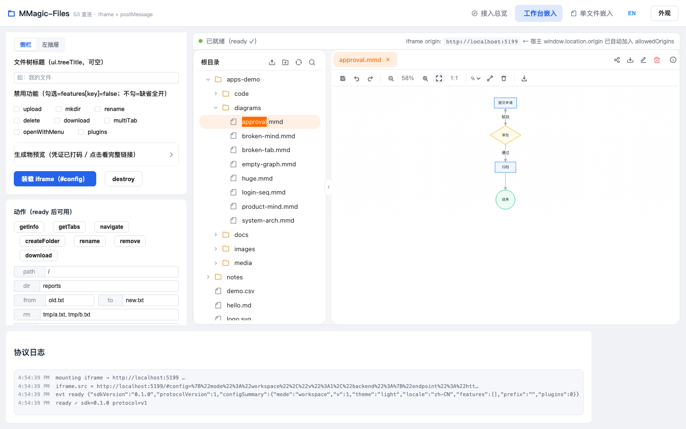 |
| re-02 | 判定节点菱形琥珀底 `#fffbeb`（语义配色） | ✅ | 同 re-01 全景可见 |
| re-03 | 自适应尺寸：三节点盒尺寸互不相同 | ✅ | 同 re-01 |

### F2 选中效果（3/3）

| 用例 | 断言 | 结果 | 截图 |
| --- | --- | --- | --- |
| re-04 | 点选节点 → boundary 虚线包围盒 | ✅ | 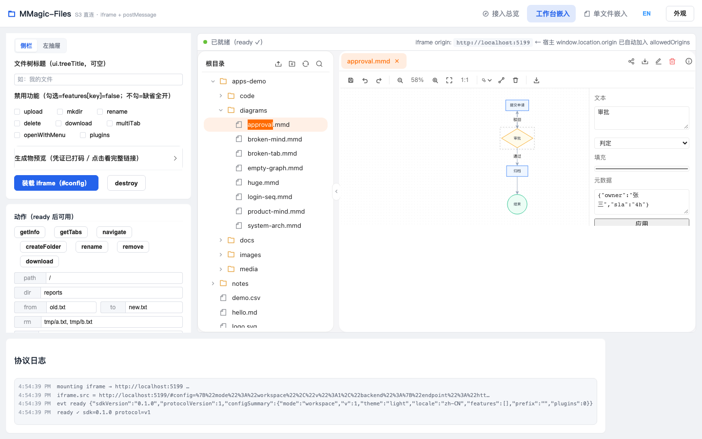 |
| re-05 | 点空白 → 选中清除 + 面板收起 | ✅ | （由 re-06 前后态覆盖） |
| re-06 | 点选边 → boundary 挂载到边 | ✅ | 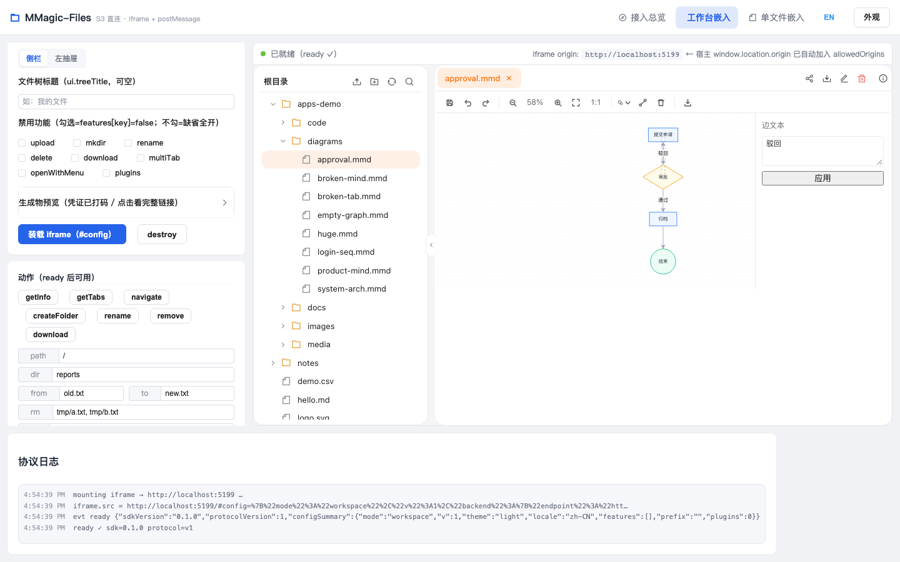 |

### F3 缩放体系（2/5）——DEF-1 / DEF-2

| 用例 | 断言 | 结果 | 截图 |
| --- | --- | --- | --- |
| re-07 | 放大一次 → 125% | ❌ 实测 183% |  |
| re-08 | 缩小一次 → 100% | ❌ 实测 263% |  |
| re-09 | Ctrl+滚轮缩放生效 | ❌ 恒 100% |  |
| re-10 | 适应画布 → ≤100% | ✅ | 由 re-11 承接 |
| re-11 | 1:1 → 100% | ✅ | 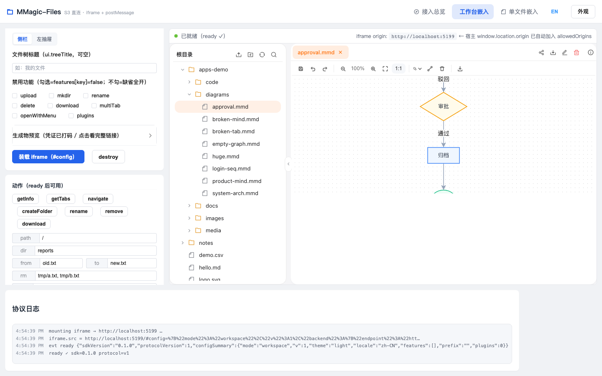 |

### F4 形状下拉与节点模板（2/2）

| 用例 | 断言 | 结果 | 截图 |
| --- | --- | --- | --- |
| re-12 | 下拉展开：5 类语义模板（色点+名称） | ✅ |  |
| re-13 | 逐类添加 5 节点（判定/开始/输入输出/结束/过程）→ 节点+5 | ✅ |  |

### F5 撤销/重做（3/3）

| 用例 | 断言 | 结果 | 截图 |
| --- | --- | --- | --- |
| re-14 | 撤销（单步）9→8 | ✅ | 由 re-16 承接 |
| re-15 | 重做（单步）8→9 | ✅ | 同上 |
| re-16 | 再撤销 9→8；undo/redo 可用性随栈翻转 | ✅ | 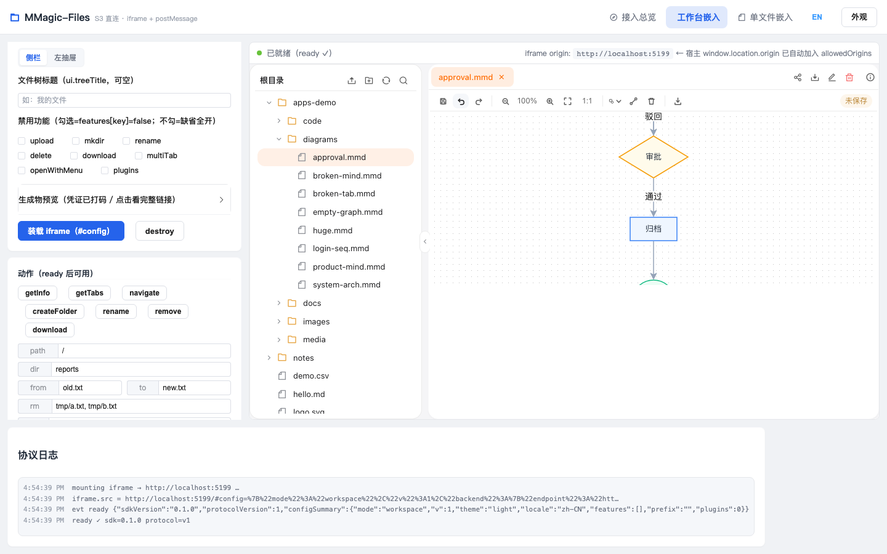 |

### F6 多行文本与自适应（2/2）

| 用例 | 断言 | 结果 | 截图 |
| --- | --- | --- | --- |
| re-17 | 多行 label：两行渲染 + 盒高 38→56 | ✅ | 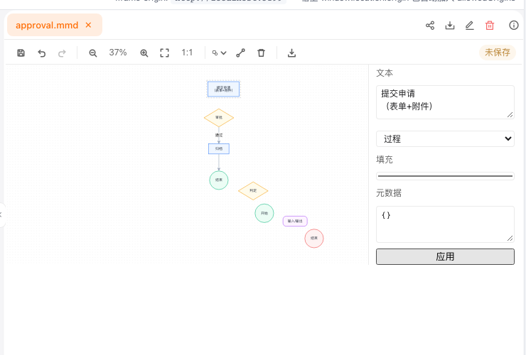 |
| re-18 | 长单行 label：盒宽 76→212 | ✅ | 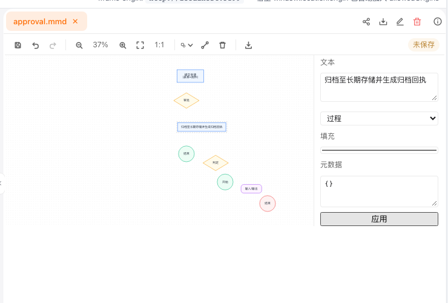 |

### F7 属性面板（2/3）——DEF-4

| 用例 | 断言 | 结果 | 截图 |
| --- | --- | --- | --- |
| re-19 | 类型切换 判定→输入输出：菱形→圆角矩形 | ✅ | 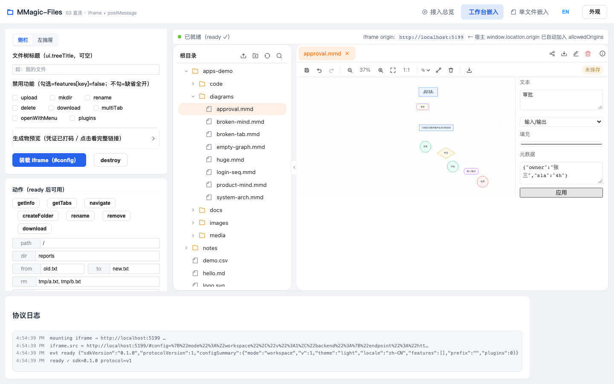 |
| re-20 | 自定义填充 `#ffcc00` 生效 | ❌ fill 仍 `#fffbeb` |  |
| re-21 | 元数据 JSON 编辑 → 应用 | ✅ | 由 re-29 持久化佐证 |

### F8 连线与边标签（2/2）

| 用例 | 断言 | 结果 | 截图 |
| --- | --- | --- | --- |
| re-22 | 连线模式两击建边 → 边+1 | ✅ |  |
| re-23 | 边标签「自动流转」上画布 | ✅ | 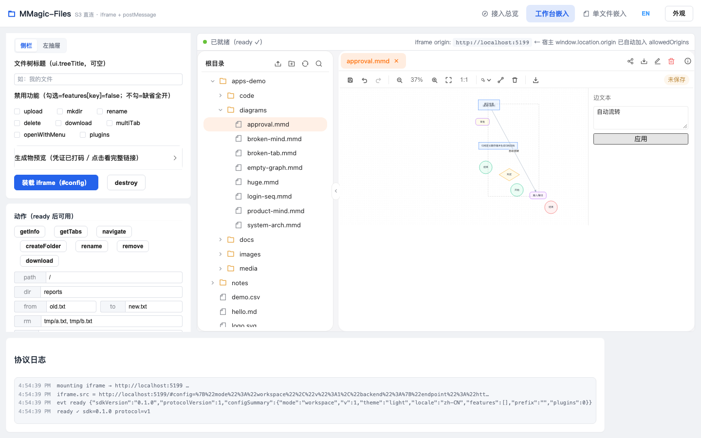 |

### F9 删除（1/2）——re-24 为测试基建

| 用例 | 断言 | 结果 | 截图 |
| --- | --- | --- | --- |
| re-24 | Delete 键删节点 + 级联删边 | ⚠️ 节点删除✅；边断言不可靠（X6 视口渲染下 DOM 计数漂移；模型后态 5→4 正确 + 单测覆盖级联） |  |
| re-25 | 「删除选中」钮删节点 | ✅ |  |

### F10 导出 SVG（0/1）——DEF-3

| 用例 | 断言 | 结果 | 截图 |
| --- | --- | --- | --- |
| re-26 | 导出触发 .svg 下载 | ❌ TypeError，无下载 |  |

### F11 关闭确认（1/1）

| 用例 | 断言 | 结果 | 截图 |
| --- | --- | --- | --- |
| re-27 | dirty 关 tab → confirm「有未保存的修改」；取消则 tab 保留 | ✅ |  |

### F12 保存链与持久化（2/3）——DEF-4 同源

| 用例 | 断言 | 结果 | 截图 |
| --- | --- | --- | --- |
| re-28 | Ctrl+S → 徽标清除 + 宿主协议 `evt fileChanged {approval.mmd, put}` | ✅ | 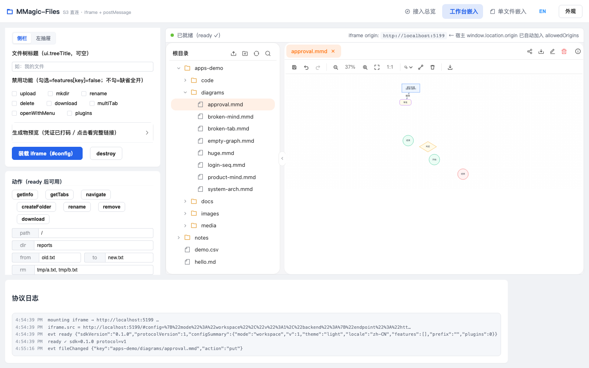 |
| re-29 | 关 tab 重开 → 多行 label / 元数据还原 | ✅ | 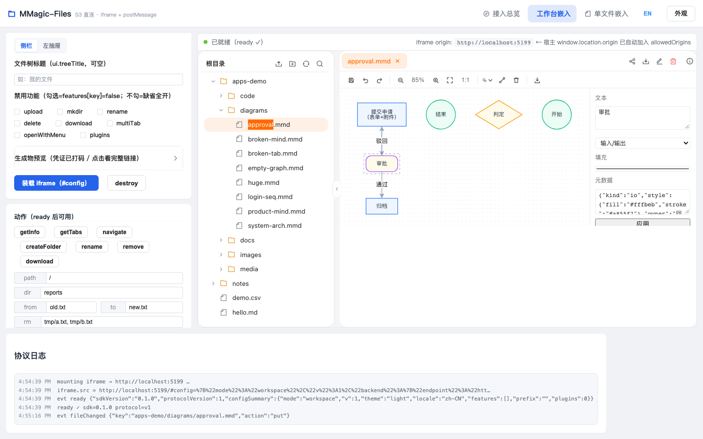 |
| re-29b | 重开 → 自定义填充还原 | ❌ 仍旧色（DEF-4） |  |

### F13 语法降级（2/2）

| 用例 | 断言 | 结果 | 截图 |
| --- | --- | --- | --- |
| re-30 | 时序图 → 只读 mermaid 渲染，无编辑画布 | ✅ | 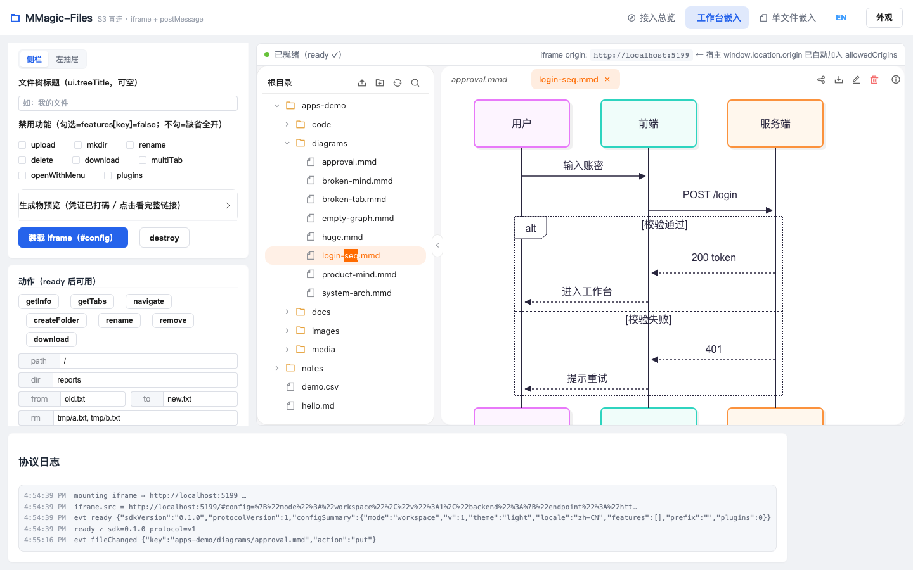 |
| re-31 | 脑图 → 只读 mermaid 渲染 | ✅ | 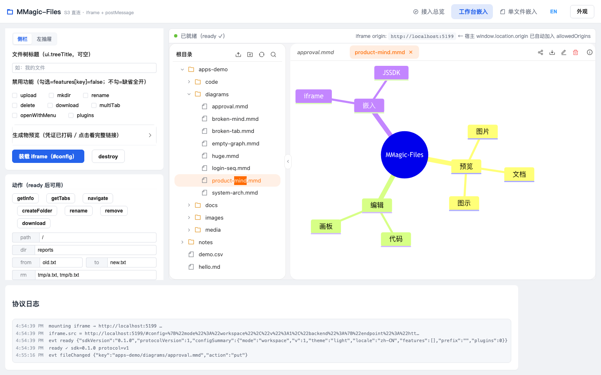 |

### F14 边界门（3/4）——re-34 为选择器错位（产品正确）

| 用例 | 断言 | 结果 | 截图 |
| --- | --- | --- | --- |
| re-32 | mindmap+tab 缩进（mermaid 必败语法）→「图示渲染失败」提示 | ✅ |  |
| re-33 | 宽容坏语法 → 不崩溃（失败提示或只读渲染） | ✅（只读渲染，见 O-1） | 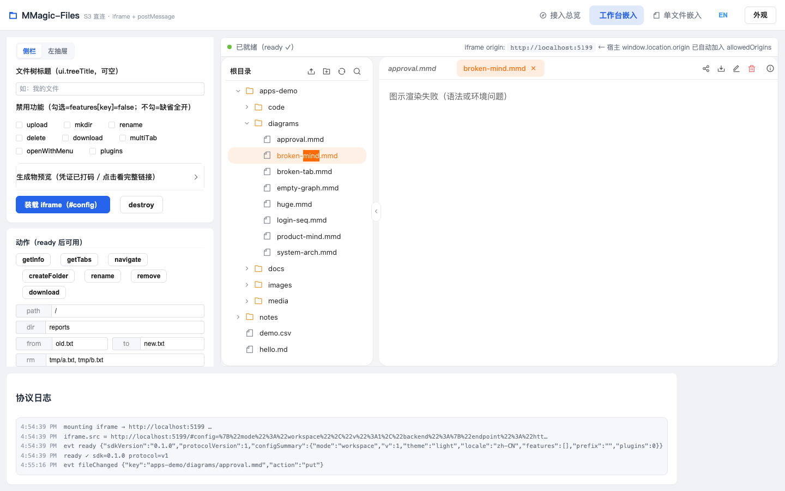 |
| re-34 | huge.mmd 5.6MB → 过大拦截、不装配画布 | ⚠️ 拦截**正确发生**（工作区预览闸第一道：「文件过大（>5.0 MB）」+ 下载按钮），断言找的是渲染器级第二道闸的选择器 | 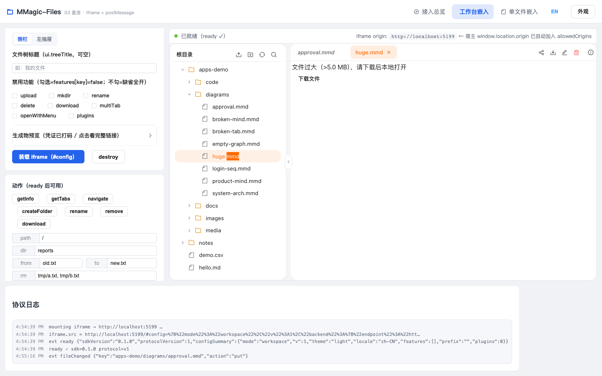（拦截实景） |
| re-35 | 空图 → 只读渲染不崩溃 | ✅ | 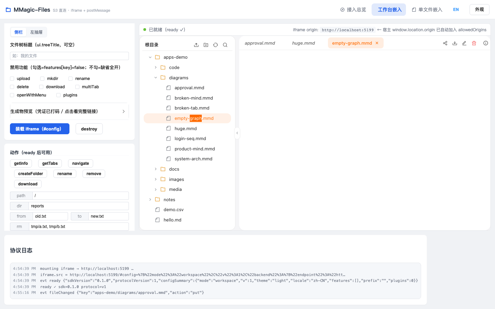 |

---

## ⑤ 测试基建收敛记录（v1→v3，脚本侧修正，不含任何产品改动）

| 轮次 | 得分 | 脚本侧问题 → 修正 |
| --- | --- | --- |
| v1 | 13/34 | ① 空白/低位点击落在 ~282px 画布外 → 动态 bbox + fit-first；② 目录重复 dblclick 反复折叠 → 展开状态记忆；③ 形状菜单开合翻转互撞 → 菜单状态跟踪；④ 场景引用被撤销吃掉的节点 → 用例重排 |
| v2 | 23/35 | ⑤ 撤销期望「一次撤 5 步」错误 → 单步语义（产品正确）；⑥ 屏幕 bbox 竞态 → 改断 `rect` 模型属性 + 轮询；⑦ v2 re-09 假通过（zoom 初值非 100% 使断言恒真）→ 先 1:1 归零再滚轮，暴露 DEF-2 |
| v3 | 28/36 | 终态。8 失败 = 6 个真缺陷佐证 + 2 个测试基建（re-24/re-34，产品行为均正确，见上表） |

**产物复算口径**：夹具上传（`artifacts/seed-fixtures.mjs`）→ 驱动（`artifacts/flow-regress.driver.mjs`）→ 结果（`artifacts/flow-regress-results.json`）。跑后已将 approval.mmd 还原为 36/36 原始种子；4 个边界夹具保留在桶中供复验。

---

## ⑥ 方法论教训（mock 假通过两例）

1. **FakeGraph.toSVG 桩掩盖 DEF-3**：单测 8/8 全绿，真机一击即溃——桩了 v1 已删除的 API。
2. **FakeGraph.zoom 乘法桩掩盖 DEF-1**：桩语义（乘法）恰好等于代码**期望**的语义，而不是真实依赖（增量）的语义。
→ 规范：mock 依赖的行为语义必须抄自真实实现（引用源码行号注释），涉及 API 存在性/语义时加一条真机 smoke 用例兜底。

## ⑦ 门控附录（与 UI 回归相互独立，均在本报告当日取得）

| 门 | 结果 |
| --- | --- |
| 单测 `vitest run` | **1209 passed** / 83 文件（flow-model 13、flow-editor 10 含其中） |
| 类型 `tsc --noEmit` | 0 错误 |
| 仓内 e2e `playwright test` | **44/44**（45.7s，S3 mock + host harness 通道） |

---

## ⑧ 修复优先级建议（汇总）

| 优先级 | 缺陷 | 一句话修复 | 预估 |
| --- | --- | --- | --- |
| P0 | DEF-1 缩放语义 | `zoomTo(getZoom()×1.25 / ×0.8)` + 钳制 | 极小 |
| P0 | DEF-3 导出崩溃 | v2 无 toSVG → 克隆画布 SVG 序列化下载 + try/catch | 小 |
| P0 | DEF-2 滚轮缩放 | 核对 v2 mousewheel 配置；兜底手工 wheel 监听 | 小 |
| P1 | DEF-4 填充被覆盖 | mergeMeta 的 style 键级合并且控件优先 + 单测 | 小 |
| P2 | DEF-5 矮视口可达性 | panning:true / 溢出自动适应 + min-height | 中 |
| P3 | O-1 宽容语法提示 / O-3 单文件闸用例 | 轻提示 + 补 `#file=` 直开用例 | 小 |
