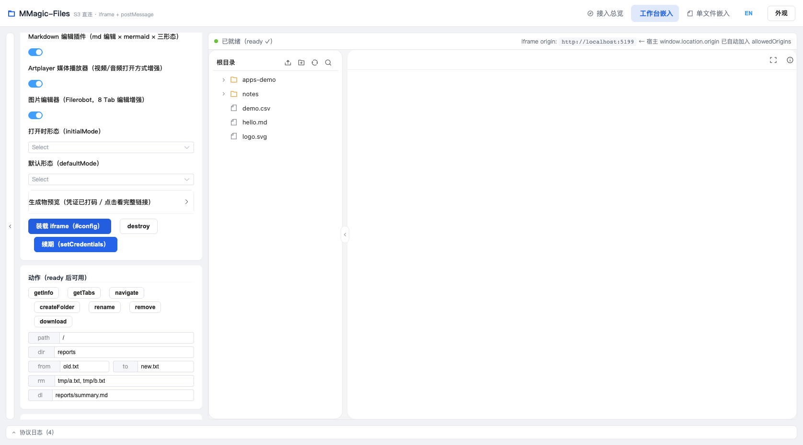
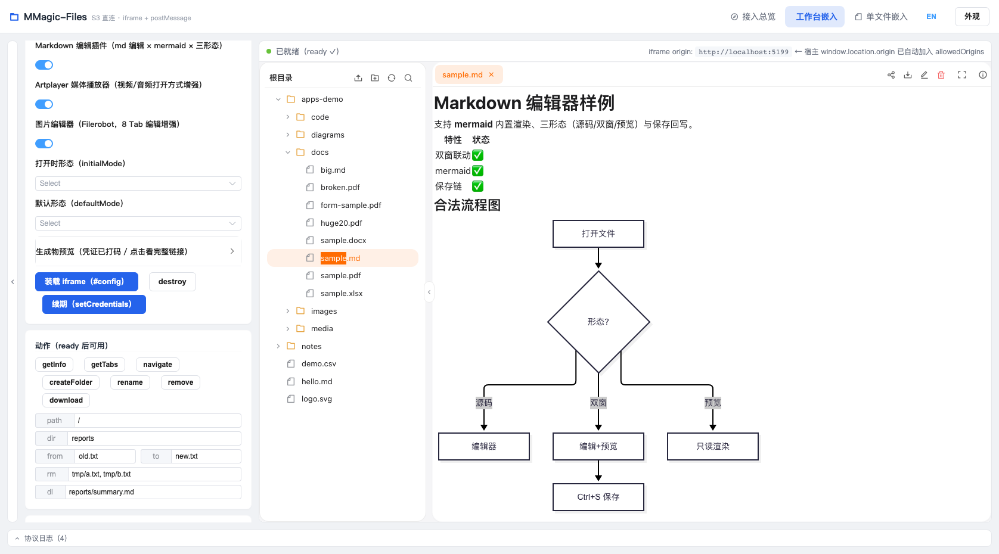
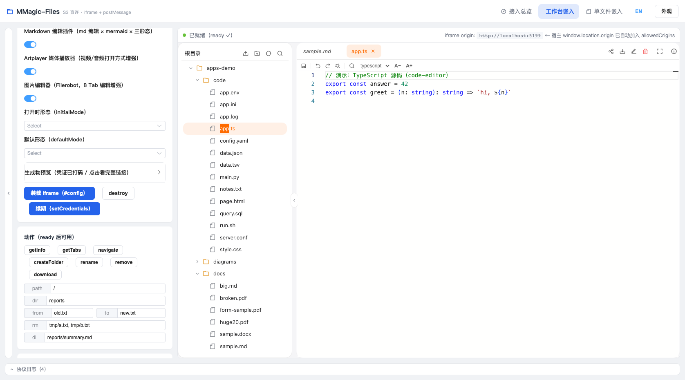
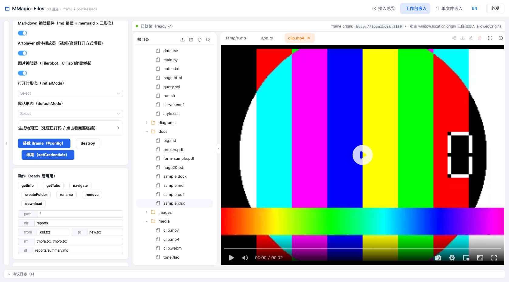
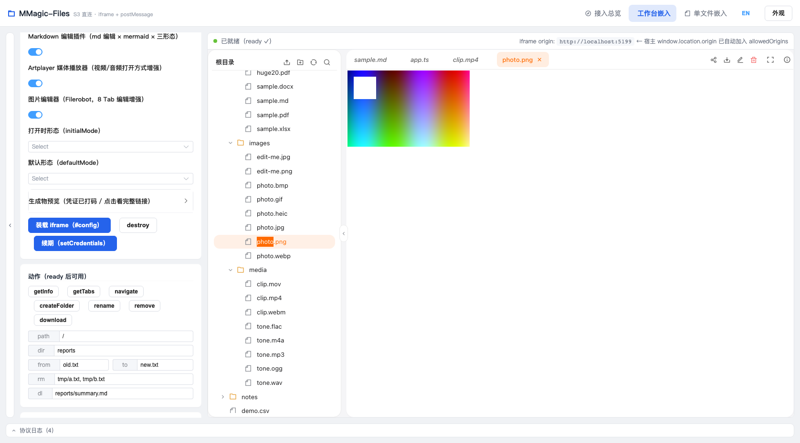
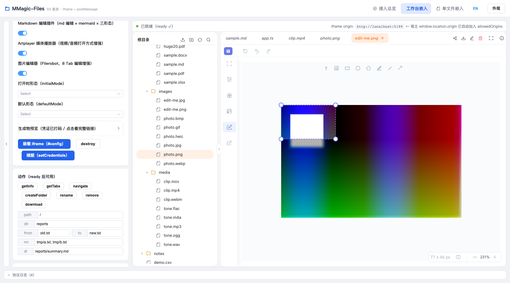

# 全量回归测试报告（2026-10-18-01）

- **报告目录**：`test-report/2026-10-18-01/`（截图 `./screenshots/`，探针/复现脚本与日志 `./artifacts/`、`./logs/`）
- **被测对象**：MMagic-Files 前端工作台（`frontend/`，dev `:5199`）+ 嵌入 demo（`mmxfiles-embed-demo`，`:5200`）+ 真实 MinIO（`:9000`，`mmagic-demo` 桶）——含本周期交付的契约 v1.1 扩展（options/applied/beforeDispose/setCredentials）与四插件（markdown-editor / artplayer / filerobot-image-editor / univer / pdf-annotator）
- **测试性质**：黑盒 E2E 实机回归（Playwright/Chromium 驱动真实服务，SigV4 真实读写，零网络 Mock）
- **铁律**：**测试过程零代码改动**——所有发现只记录与举证，源码与交付态完全一致
- **门控口径**：单测（vitest）+ 类型（vue-tsc）+ 仓内 E2E（44 用例）+ UI 关键路径实机取证（K1~K7）

---

## ① 执行概要

| 门控 | 结果 | 耗时 | 日志 |
| --- | --- | --- | --- |
| 单元测试（vitest） | **1336 通过 / 1 skipped（89 文件）** | 13.4s | `logs/vitest.log` |
| 类型检查（vue-tsc -b --noEmit） | **0 错误** | — | `logs/tsc.log` |
| 仓内 E2E（Playwright，11 spec） | **44 / 44 通过** | 44.7s | `logs/run-full.log` |
| UI 关键路径实机取证（K1~K7） | **7/7 通过**（含 1 处测试基建修正，见 §④） | — | `artifacts/key-evidence-results.json` |

**结论**：三道自动门控全绿，UI 关键路径 7 条全部实机验证通过。唯一实质发现 **DEF-1（P2）：Monaco dispose 竞态未捕获异常**——控制台级 pageerror，界面无可见故障，快速连开预览（600ms 节奏）可稳定复现，详见 §⑤。

---

## ② 仓内 E2E 结果矩阵（11 业务线 44 用例，全通过）

| # | 业务线 | spec | 用例 | 结果 |
| --- | --- | --- | --- | --- |
| L0 | 预热基线 | 00-warmup | 1 | ✅ 1/1 |
| L1 | boot 错误态（无配置/坏 JSON/版本/连接向导遮罩） | line1 | 4 | ✅ 4/4 |
| L2 | workspace 浏览（树渲染/原位展开/懒加载聚合翻页/List 500 重试） | line2 | 4 | ✅ 4/4 |
| L3 | 渲染器预览（md/png/csv/txt/mp4/未匹配 fallback/取流 500 错误边界） | line3 | 7 | ✅ 7/7 |
| L4 | 工具栏操作（新建目录/删除/重命名 copy+delete/刷新） | line4 | 4 | ✅ 4/4 |
| L5 | 上传（PUT 入树/denyExts/超限/重名冲突确认） | line5 | 4 | ✅ 4/4 |
| L6 | 会话到期（遮罩+expired 事件/终态命令回包 5000） | line6 | 2 | ✅ 2/2 |
| L7 | features 门控（remove 4301/UI 隐藏/整链拒绝） | line7 | 3 | ✅ 3/3 |
| L8 | 单文件模式（只读 #file/可写 save 段） | line8 | 2 | ✅ 2/2 |
| L9 | office 预览（docx 非法 zip 降级/xlsx 真实 zip+sheet 切换） | line9 | 2 | ✅ 2/2 |
| L10 | 插件失败路径（不可达 URL 4201/SRI 不符 4201） | line10 | 2 | ✅ 2/2 |
| L11 | 工作台交互面（右键菜单/drop 上传/多选批量/取消/粘贴/预览 tab 条/分享预签名/命令面板） | line11 | 8 | ✅ 8/8 |
| — | **合计** | 11 | **44** | **✅ 44/44（44.7s）** |

---

## ③ UI 关键路径实机证据（通过侧关键图）

> 驱动脚本 `artifacts/key-evidence.mjs`，逐条断言+截图；`only-on-failure` 口径下全过无自动截图，故关键证据为主动实拍。

| # | 关键路径 | 证据 | 实测断言 |
| --- | --- | --- | --- |
| K1 | 工作台装配（iframe+SDK 就绪+树加载） |  | apps-demo 节点可见，协议 ready ✓ |
| K2 | 内置 markdown+mermaid 预览（静默降级定版） |  | 渲染正常，无 mermaid 炸弹图/错误文本 ✓ |
| K3 | code 渲染器（Monaco） |  | app.ts 打开，Monaco 挂载 ✓ |
| K4 | Artplayer 插件（打开方式链路） |  | `.ap-root`+`.ap-stage`+`art-video-player`+video(2s/320px) ✓ |
| K5 | 图片查看器 |  | 图片元素挂载 ✓ |
| K6 | Filerobot 编辑器（图标化+顶栏重排新 UI） |  | 挂载 ✓ 保存图标 28×26 ✓ 撤销组移左 ✓ 缩放组右下 ✓ 工具面板顶部居中 ✓ |
| K7 | 右键菜单 |  | 打开/打开方式/重命名/删除/下载 菜单齐 ✓ |
| ERR | demo 页 pageerror | — | K1~K7 常规节奏下 0 pageerror（快速连开节奏的例外见 DEF-1） |

---

## ④ 发现 1（测试基建，产品正确）：K4 首轮断言错位

- **现象**：首轮驱动 K4 双击 `clip.mp4` 后断言 `.artplayer` 选择器未命中 → FAIL。
- **取证**：`K4-artplayer.png` 首轮截图显示原生 `<video controls>`（2s/320px）在正常播放——**双击默认打开的是内置 video 渲染器（设计行为）**；Artplayer 插件注册为打开方式增强（`actions:['edit']` 不抢默认位），须走右键 →「Artplayer 播放器」链路。
- **修正后**：右键链路实测 `apRoot:true`、`art-video-player art-subtitle-show art-layer-show art-contro…`（artplayer 5.x 真实根类名），video 2s/320px ✓ → **PASS**。
- **定性**：测试脚本选择器口径错误，产品行为正确（与 2026-10-13 报告 F9/F14 同类）。修正脚本已固化：`artifacts/k4-probe.mjs`。
- **顺带发现（建议项 S-3）**：artplayer 根类 `art-video-player` 与插件自带 `.ap-root/.ap-stage` 双层并存，无功能问题，仅提示后续断言用 `.ap-root`（插件自有类，light DOM 稳定可达）。

---

## ⑤ 发现 2（DEF-1，P2）：Monaco dispose 竞态 → 未捕获异常（pageerror）

- **现象**：快速连开预览（600ms/步节奏）时，`clip.mp4` 接管预览（takeOver）瞬间，控制台冒未捕获异常 `TypeError: Cannot read properties of undefined (reading '0')`。**界面无任何可见故障**——新预览正常渲染、工作台不崩；但违反「0 pageerror」门控，且 emitter 队列重入存在内部状态残留/泄漏风险。
- **复现率**：完整链 **3/3 稳定复现**（`artifacts/bisect-error.mjs`）；放松到 800ms/步或减步（只开 md 或只开 ts 后接 media）**0/4 复现**（`bisect2.mjs`/`bisect3.mjs`）。
- **复现链**：装配 → 展开 apps-demo → docs → 开 `sample.md` → code → 开 `app.ts` → **media →（展开瞬间连开）** → clip.mp4 takeOver 接管 Monaco 实例时触发。
- **证据**：
  - 事发时刻截图（界面正常、异常在 console 层）：
  - 完整 stack 落盘：`artifacts/DEF-1-stack.txt`（关键帧：`preview.ts open → takeOver → teardown → code.ts dispose → Monaco StandaloneEditor.setModel → _postDetachModelCleanup → Emitter._deliverQueue undefined[0]`，且 stack 内 dispose→fire→dispose 嵌套两层）
- **根因（源码级）**：
  1. `frontend/src/apps/renderers/code.ts` dispose（~L438-444）**同步二连触发**：`editor.getModel()?.dispose()` 先炸 model detach 事件，紧接着 `editor.dispose()` 又 `setModel(null)` 二次触发 `_postDetachModelCleanup`；
  2. Monaco（0.57.0）内部 emitter 队列投递走**微任务**（stack 底部 `chunk:129` 派发帧）——`preview.ts` teardown（L131-136）虽已给 `inst.dispose()` 包了 try/catch，但**异常在微任务里异步冒出，宿主 catch 拦不住**，成为 uncaught；
  3. 触发窗口 = 前序编辑器事件尚在队列投递中 + takeOver 同步 teardown，600ms 节奏恰好踩进，800ms 避开。
- **影响面**：仅 code-editor 渲染器（Monaco 唯一使用方）；markdown/painter/flow 等其它渲染器 dispose 无此模式。用户可见功能无损。
- **✅ 修复后复核（2026-10-18 当日，方案 A 已执行）**：`code.ts` dispose 顺序反转（editor 先毁、model 后毁）+ 同步段 try/catch（`CODE_DISPOSE_ERR`）。复核结果：原复现脚本真实链 **3/3 全 0 pageerror**（修复前 3/3 必炸）；新增回归门 `render-08`（600ms 快速连开）通过；全量 e2e **45/45**；code 单测 36/36；tsc 0 错；K1~K7 复拍 8/8。修法与验证明细见《修复建议.md》§一。

---

## ⑥ 基建侧记录（非产品缺陷）

| # | 事项 | 说明 |
| --- | --- | --- |
| B-1 | pnpm verify-deps 钩子拦截测试命令 | `pnpm exec playwright/vitest` 需带 `--config.verify-deps-before-run=false`（protobufjs 构建脚本审批策略），已入操作口径 |
| B-2 | Playwright `screenshot:'only-on-failure'` 全过即零截图 | 通过侧证据需主动驱动实拍（本次已固化 `key-evidence.mjs`，后续回归可复用） |
| B-3 | 首轮全量误跑 `pnpm install` | playwright config webServer 复用已起服务，但 pnpm 钩子先崩——B-1 同源 |

---

## ⑦ 结论

- **产品质量**：三道自动门控（单测 1336/tsc 0/E2E 44）全绿 + UI 关键路径 7/7 实证，本周期交付面（契约 v1.1 扩展、四插件、mermaid 静默降级、Filerobot UI 改版）**无功能级回归**。
- **遗留唯一 P2**：DEF-1 Monaco dispose 竞态（修复建议见同目录《修复建议.md》，本报告不修代码）。
